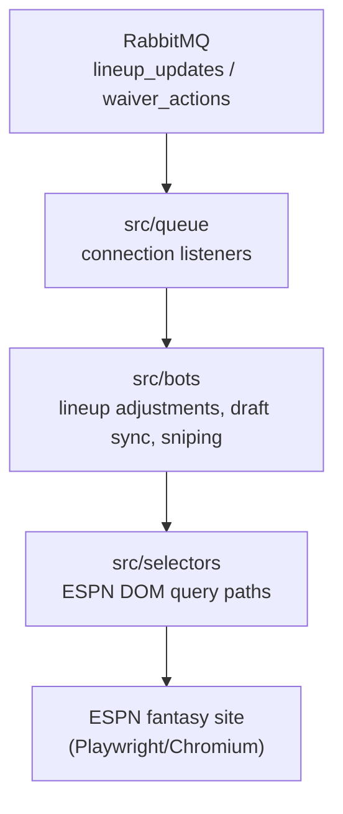
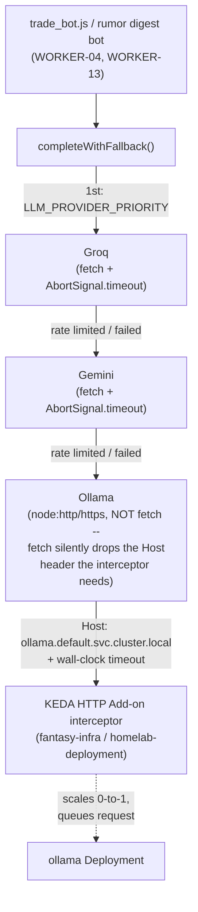

# fantasy-browser-worker

The headless execution worker layer of your automated fantasy football platform. It maps automated actions straight to the ESPN portal using node.js and Playwright.

## Repository Layout
*   `src/queue/`: RabbitMQ connection listeners that capture inbound activation payloads from the FastAPI gateway.
*   `src/bots/`: Automated scripts handling physical transaction flows (Lineup adjustments, live draft sync, and fast sniping).
*   `src/selectors/`: Static element layout definitions tracking ESPN DOM query paths.
*   `docs/`: Reverse-engineering notes on ESPN's own (undocumented) draft protocol and auth behavior — see below.

## Documentation
[`docs/espn-reverse-engineering.md`](docs/espn-reverse-engineering.md) documents everything this project has confirmed about ESPN's actual draft-room WebSocket protocol, which REST endpoints are reliable, verified draft-room DOM selectors, and the cookie-auth-vs-real-login split (including why scripting the login form is a dead end). A `CLAUDE.md` with a shorter, ticket-oriented summary of the same and other project-specific gotchas exists locally for AI-assisted development but isn't tracked in this repo (gitignored, matching the other `fantasy-*` repos' convention) — not linked here since the path wouldn't resolve on GitHub.

## Local Configuration
Make sure your system layout supports local browser binaries before launching:
```bash
npm install
npx playwright install chromium
```

## Architecture
Cross-repo architecture and reference docs for the whole platform live in [`fantasy-core-pipeline`'s `ARCHITECTURE.md`](https://github.com/cvillarr23/fantasy-core-pipeline/blob/main/ARCHITECTURE.md).

This service's own internals:



### WORKER-12: LLM client provider fallback chain

`src/lib/llm_client.js`'s `completeWithFallback` tries each configured provider in order,
falling through on a rate limit, quota exhaustion, or any other request failure. Ollama is the
last resort and is reached only through `fantasy-infra`'s KEDA HTTP Add-on interceptor, never
called or scaled directly:



Every attempt (winner or not) writes a best-effort row to `llm_call_metrics` for CORE-14's
Grafana dashboard — see `CLAUDE.md`'s WORKER-12 notes for the metrics schema and rate-limiter
details.

## Image release + Argo CD Image Updater contract
- Pushes to `main` publish:
  - `ghcr.io/cvillarr23/fantasy-browser-worker:latest`
  - `ghcr.io/cvillarr23/fantasy-browser-worker:${GITHUB_SHA}`
- CI records the pushed immutable digest (`@sha256:...`) in the workflow summary.
- `fantasy-infra` owns Argo CD Image Updater configuration and should track this image via digest strategy, writing back deterministic Kustomize digest updates to `main`.

## Project Tracking
Engineering tickets for this repo live as [GitHub Issues](https://github.com/cvillarr23/fantasy-browser-worker/issues) and are tracked on the [Fantasy Manager project board](https://github.com/users/cvillarr23/projects/2), alongside `fantasy-core-pipeline` and `fantasy-infra`.
