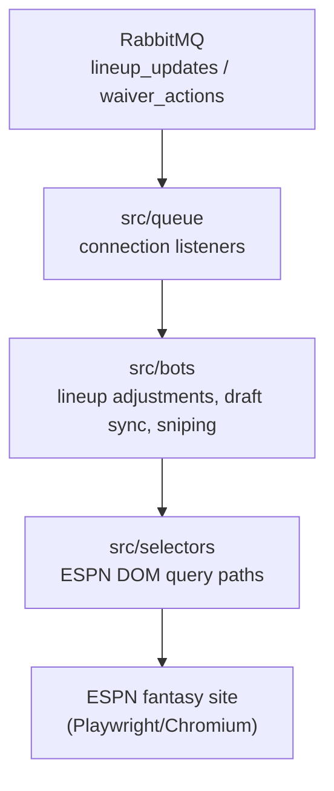
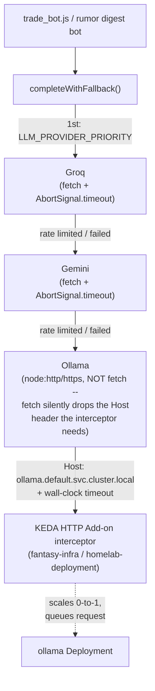

# fantasy-browser-worker

The headless execution worker layer of your automated fantasy football platform. It maps automated actions straight to the ESPN portal using node.js and Playwright.

## Repository Layout
*   `src/queue/`: RabbitMQ connection listeners that capture inbound activation payloads from the FastAPI gateway.
*   `src/bots/`: Automated scripts handling physical transaction flows (Lineup adjustments, live draft sync, and fast sniping).
*   `src/selectors/`: Static element layout definitions tracking ESPN DOM query paths.
*   `docs/`: Reverse-engineering notes on ESPN's own (undocumented) draft protocol and auth behavior — see below.

## Documentation
[`docs/espn-reverse-engineering.md`](docs/espn-reverse-engineering.md) documents everything this project has confirmed about ESPN's actual draft-room WebSocket protocol, which REST endpoints are reliable, verified draft-room DOM selectors, and the cookie-auth-vs-real-login split (including why scripting the login form is a dead end).

## Local Configuration
Make sure your system layout supports local browser binaries before launching:
```bash
npm install
npx playwright install chromium
```

## Architecture
Cross-repo architecture and reference docs for the whole platform live in [`fantasy-core-pipeline`'s `ARCHITECTURE.md`](https://github.com/cvillarr23/fantasy-core-pipeline/blob/main/ARCHITECTURE.md).

This service's own internals:



### LLM client provider fallback chain

`src/lib/llm_client.js`'s `completeWithFallback` tries each configured provider in order,
falling through on a rate limit, quota exhaustion, or any other request failure. Ollama is the
last resort and is reached only through `fantasy-infra`'s KEDA HTTP Add-on interceptor, never
called or scaled directly:



Every attempt (winner or not) writes a best-effort row to `llm_call_metrics` for
the Grafana dashboard.

### Rumor digest bot

`src/bots/rumor_digest_bot.js` batches new `raw_signals` rows (from `fantasy-core-pipeline`) into
a single `completeWithFallback` call and persists structured per-player verdicts to
`rumor_signals` — advisory only, no waiver/lineup execution.

### Trade negotiation test job (`k8s/test-trade-bot-job.yaml`)

Rehearses `trade_bot.js`'s `negotiateTradeProposal` against a real pending trade. Advisory only —
it scrapes, grounds against roster-deficit/VORP data, calls the LLM for a counter-offer, and logs
it; no AI-drafted message is generated, and nothing is ever posted to ESPN on your behalf. Its
`execution_log` write (`offering_team_id`/`counter_offer`/`dry_run` columns) will silently no-op
until those columns are added on `fantasy-core-pipeline`'s side — expected, not a bug in this job.

## Image release + Argo CD Image Updater contract
- Pushes to `main` publish:
  - `ghcr.io/cvillarr23/fantasy-browser-worker:latest`
  - `ghcr.io/cvillarr23/fantasy-browser-worker:${GITHUB_SHA}`
- CI records the pushed immutable digest (`@sha256:...`) in the workflow summary.
- `fantasy-infra` owns Argo CD Image Updater configuration and should track this image via digest strategy, writing back deterministic Kustomize digest updates to `main`.

### Outgoing trade proposals

The low-level `trade_proposals` consumer accepts
`{"season":2026,"week":4,"tracking_id":"proposal-2026-4"}`. The worker ranks other teams' positional deficits, reads our
roster and the highest-ranked target's live ESPN roster, and uses
`completeWithFallback` to draft one fresh offer and a pitch. It can return
`no_target` or `no_offer` without staging anything. Ownership, duplicate ids,
nonempty sides, and a player at the targeted position are checked before staging.
Player ids come exclusively from ESPN; no Sleeper/internal player ids are sent
to the trade builder. The deficit service must describe the configured ESPN
league and use its team ids (the service currently tracks one league).

Offers are staged with `source: "proposal"`, never with an approval from the
request. `trade_builder` records the offer and pitch in `execution_log`; this
worker does not write `bot_decisions`. The existing separate approval and
`trade_submissions` flow is required to send. The pitch is part of the approval's
`offer_key`. Check `messageAttached`: if ESPN has no note field, the pitch is not
sent; this generator does not automatically post it to league chat. Staging
failures return `fill_failed` with the computed offer rather than regenerating
on a queue retry. Model/read failures use delayed retries; invalid requests are
permanent failures.

### Outgoing scan cadence

Production uses one standalone `trade-scan` CronJob in fantasy-infra, Wednesday
10:00 America/Chicago, after the daily projection/VORP refresh and waiver window.
One candidate per week limits LLM cost and review noise while leaving time before
Thursday games. Like rumor digest, it calls a bot entrypoint directly. There is
no scheduled queue producer and deliberately no `trade_proposals` KEDA trigger;
do not publish manual scans to that queue (an idle worker will not wake for it).
The low-level consumer remains compatible for existing callers but bypasses the
scheduled scan claim; use the CLI below for operational scans.

The [Sleeper NFL state endpoint](https://docs.sleeper.com/#get-nfl-state) supplies
`season` and `week`, not `league_season`, `display_week`, or a hardcoded year.
Only regular-season weeks 1–18 run; preseason/postseason/week zero and February–
August are successful no-ops before claims/browser/LLM access. Invalid, unavailable,
or stale season data fails closed. This is an NFL calendar gate, not a check of
the ESPN league's trade deadline; suspend the CronJob when that league closes
trading. Existing ESPN staging validation and all approval/submission gates apply.

An atomic Postgres advisory transaction lock plus a durable `execution_log`
`trade_scan_claim` row allows one attempt per ESPN league/team/season/week,
including overlapping manual Jobs. Claims persist on no-target/no-offer, errors,
and timeouts. There are no automatic scan retries: different generated pitches
have different approval keys. Failures require inspection; ordinarily wait for
next week. Do not delete claim rows in execution-log retention during the current
season. No new schema is required, but existing `counter_offer` JSONB and `dry_run`
columns and DB write permissions are required. Unlike best-effort telemetry,
claim writes fail closed. Claims are not proof an offer was staged: inspect the
`trade_scan` outcome and `trade_offer_submit` rows too.

Safe manual check (live calendar read only; no claim, DB write, browser or LLM):

```bash
ESPN_LEAGUE_ID=123 ESPN_TEAM_ID=7 node src/bots/trade_scan.js --check
```

An explicit `--stage` runs the same weekly claim and proposal path as the CronJob,
and can fill an ESPN trade form for review; it never supplies an approval or sends
league chat. There is no force/bypass flag. For an in-cluster read-only check after
rollout, create a Job manifest locally and change its command before creating it:

```bash
kubectl create job trade-scan-check --from=cronjob/trade-scan --dry-run=client -o json > /tmp/trade-scan-check.json
python3 -c 'import json; p="/tmp/trade-scan-check.json"; d=json.load(open(p)); d["spec"]["template"]["spec"]["containers"][0]["command"]=["node","src/bots/trade_scan.js","--check"]; json.dump(d,open(p,"w"))'
kubectl create -f /tmp/trade-scan-check.json
kubectl logs -f job/trade-scan-check
```

The CLI has a 15-minute hard deadline; Kubernetes additionally bounds Pending
and Running time to 16 minutes, allows a 30-minute late start, forbids concurrent
scheduled Jobs, and uses `backoffLimit: 0`. Structured completion logs include
status, season/week, scan key, tracking ID and staging status; `--stage` records
`trade_scan` spans/execution outcomes. Unexpected errors exit nonzero. Existing
infra CronJob missed-schedule/failed-Job alerts include `trade-scan`.

Deployment order: release the worker image containing this entrypoint, confirm
fantasy-infra's production image digest includes it, then sync the new CronJob.
It reuses fantasy-league-config, ESPN cookies, DB credentials, Groq/Gemini keys,
core-pipeline roster deficits and the existing LLM fallback/telemetry services.
No queue declaration, KEDA trigger, core-pipeline change or new secret is needed.
