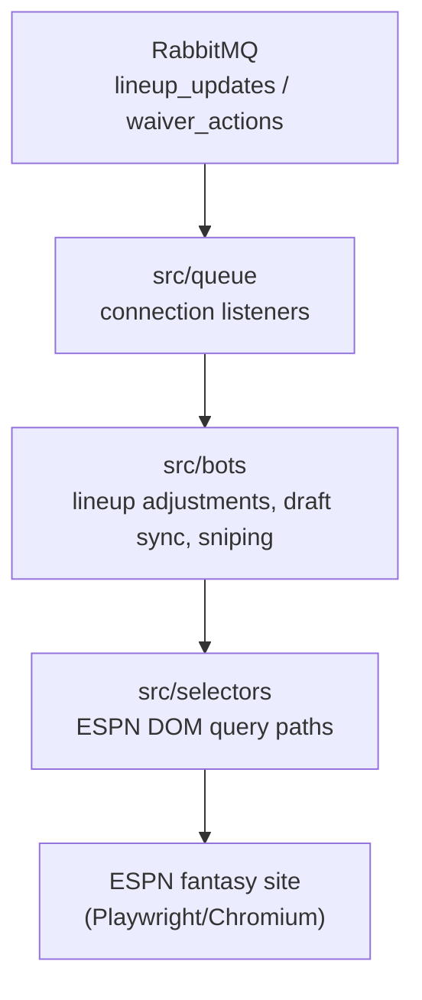
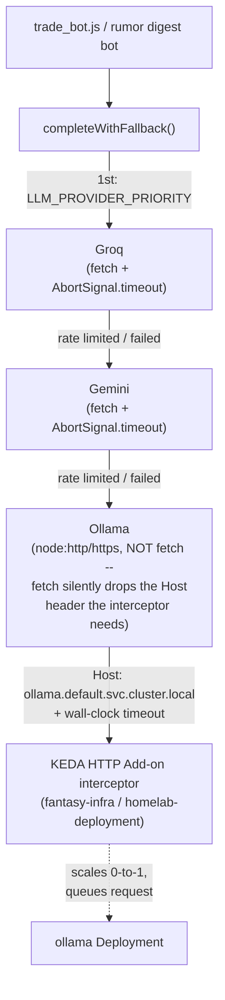

# fantasy-browser-worker

The headless execution worker layer of your automated fantasy football platform. It maps automated actions straight to the ESPN portal using node.js and Playwright.

## Repository Layout
*   `src/queue/`: RabbitMQ connection listeners that capture inbound activation payloads from the FastAPI gateway.
*   `src/bots/`: Automated scripts handling physical transaction flows (Lineup adjustments, live draft sync, and fast sniping).
*   `src/selectors/`: Static element layout definitions tracking ESPN DOM query paths.
*   `docs/`: Reverse-engineering notes on ESPN's own (undocumented) draft protocol and auth behavior — see below.

## Documentation
[`docs/espn-reverse-engineering.md`](docs/espn-reverse-engineering.md) documents everything this project has confirmed about ESPN's actual draft-room WebSocket protocol, which REST endpoints are reliable, verified draft-room DOM selectors, and the cookie-auth-vs-real-login split (including why scripting the login form is a dead end).

## Local Configuration
Make sure your system layout supports local browser binaries before launching:
```bash
npm install
npx playwright install chromium
```

## Architecture
Cross-repo architecture and reference docs for the whole platform live in [`fantasy-core-pipeline`'s `ARCHITECTURE.md`](https://github.com/cvillarr23/fantasy-core-pipeline/blob/main/ARCHITECTURE.md).

This service's own internals:



### LLM client provider fallback chain

`src/lib/llm_client.js`'s `completeWithFallback` tries each configured provider in order,
falling through on a rate limit, quota exhaustion, or any other request failure. Ollama is the
last resort and is reached only through `fantasy-infra`'s KEDA HTTP Add-on interceptor, never
called or scaled directly:



Every attempt (winner or not) writes a best-effort row to `llm_call_metrics` for
the Grafana dashboard.

### Rumor digest bot

`src/bots/rumor_digest_bot.js` batches new `raw_signals` rows (from `fantasy-core-pipeline`) into
a single `completeWithFallback` call and persists structured per-player verdicts to
`rumor_signals` — advisory only, no waiver/lineup execution.

### Trade negotiation test job (`k8s/test-trade-bot-job.yaml`)

Rehearses `trade_bot.js`'s `negotiateTradeProposal` against a real pending trade. Advisory only —
it scrapes, grounds against roster-deficit/VORP data, calls the LLM for a counter-offer, and logs
it; no AI-drafted message is generated, and nothing is ever posted to ESPN on your behalf. Its
`execution_log` write (`offering_team_id`/`counter_offer`/`dry_run` columns) will silently no-op
until those columns are added on `fantasy-core-pipeline`'s side — expected, not a bug in this job.

## Image release + Argo CD Image Updater contract
- Pushes to `main` publish:
  - `ghcr.io/cvillarr23/fantasy-browser-worker:latest`
  - `ghcr.io/cvillarr23/fantasy-browser-worker:${GITHUB_SHA}`
- CI records the pushed immutable digest (`@sha256:...`) in the workflow summary.
- `fantasy-infra` owns Argo CD Image Updater configuration and should track this image via digest strategy, writing back deterministic Kustomize digest updates to `main`.

### Outgoing trade proposals

The low-level `trade_proposals` consumer accepts
`{"season":2026,"week":4,"tracking_id":"proposal-2026-4"}`. A run works like this:

1. The worker ranks other teams' positional weaknesses and keeps the worst one
   on each of up to three teams. A position is weak when the team is short of
   starters there or its `net_vorp` is below the league average for that
   position. Mid-season rosters are full, so the second case is the usual one.
2. It reads core's `GET /v1/trade/context` once, with a four-week horizon, for
   ESPN-keyed rosters.
3. One `completeWithFallback` call proposes up to six candidate packages. These
   are ids only, with no pitch and no numbers. Ownership, duplicate ids, nonempty
   sides, and a player at the targeted position are checked for each package, and
   invalid packages are dropped.
4. Each remaining package is scored with core's `POST /v1/trade/score`, one after
   another (`TRADE_SCORE_TIMEOUT_MS`, default 30s; `TRADE_CONTEXT_TIMEOUT_MS` for
   the context read).

A package is useful only when:
- our lineup gain is positive;
- the counterparty's lineup doesn't get worse;
- neither roster goes over its limit;
- every traded player is mapped;
- at least one horizon week was scored.

Useful packages are ranked as follows:
1. Packages with a schedule-weighted `final_score` rank ahead of those without
   one. Those without one rank by their unweighted lineup gain, and the two
   scales are never compared.
2. Within that, by value per scored week. Unscored weeks (missing metrics, unknown
   opponent strength) are unknown, never zero.
3. Ties go to more scored weeks, then a complete horizon, then the larger
   counterparty lineup change.

The winner's pitch comes from a second LLM call that sees only counterparty-facing
evidence drawn from the score. It never sees our own gain or `final_score`. It must
cite evidence ids and may not state a number that isn't in that evidence.

Results:
- `no_target`: there is no target.
- `no_offer`, with a `reason` (`no_packages`, `no_valid_packages`,
  `no_useful_offer`, `pitch_rejected`, `evaluation_too_large`) and the
  per-package rejections. Nothing is staged.
- An error: core couldn't score any package. Nothing is ever staged unscored.

Player ids come exclusively from ESPN; no Sleeper/internal player ids are sent
to core's scorer or the trade builder. The deficit service must describe the configured ESPN
league and use its team ids (the service currently tracks one league).

The staged row's `counter_offer.evaluation` holds the score evidence for
reviewers. It has these fields:
- `version` (`proposal-evaluation-v1`) and `evaluated_at`;
- `request`: the exact score request, including `week` and `horizon`;
- `score`: the verbatim `TradeScore` response;
- `target` and `ranking`;
- `pitch`: the message, the evidence items with JSON Pointers into `score`, and
  the cited evidence ids.

The evaluation is not part of the `offer_key`.

Offers are staged with `source: "proposal"`, never with an approval from the
request. `trade_builder` records the offer and pitch in `execution_log`; this
worker does not write `bot_decisions`. The existing separate approval and
`trade_submissions` flow is required to send. The pitch is part of the approval's
`offer_key`. Check `messageAttached`: if ESPN has no note field, the pitch is not
sent; this generator does not automatically post it to league chat. Staging
failures return `fill_failed` with the computed offer rather than regenerating
on a queue retry. Model/read failures use delayed retries; invalid requests are
permanent failures.

### Outgoing scan cadence

Production uses one standalone `trade-scan` CronJob in fantasy-infra, Wednesday
and Friday at 13:00 America/Chicago. Wednesday reviews post-waiver rosters; Friday
provides another look after Thursday's game. Both run after the daily projection/
VORP refresh and 11:00 rumor digest. Trade prompts do not yet consume rumor signals;
this ordering leaves room for a future integration without implying news grounding.
Two scheduled candidates per week limit LLM cost and review noise. Like rumor digest, it calls a bot entrypoint directly. There is
no scheduled queue producer and deliberately no `trade_proposals` KEDA trigger;
do not publish manual scans to that queue (an idle worker will not wake for it).
The low-level consumer remains compatible for existing callers but bypasses the
scheduled scan claim; use the CLI below for operational scans.

The [Sleeper NFL state endpoint](https://docs.sleeper.com/#get-nfl-state) supplies
`season` and `week`, not `league_season`, `display_week`, or a hardcoded year.
Only regular-season weeks 1–18 run; preseason/postseason/week zero and February–
August are successful no-ops before claims/browser/LLM access. Invalid, unavailable,
or stale season data fails closed. This is an NFL calendar gate, not a check of
the ESPN league's trade deadline; suspend the CronJob when that league closes
trading. Existing ESPN staging validation and all approval/submission gates apply.

An atomic Postgres advisory transaction lock plus a durable `execution_log`
`trade_scan_claim` row allows one attempt per ESPN league/team/Chicago calendar date,
including overlapping manual Jobs. Claims persist on no-target/no-offer, errors,
and timeouts. There are no automatic scan retries: different generated pitches
have different approval keys. Failures require inspection; ordinarily wait for
the next scheduled day. A manual staging run on an unscheduled day is permitted,
but all same-day runs share a claim, including across UTC midnight and NFL week
metadata changes. Date boundaries follow Chicago daylight saving time. This is
scan deduplication, not a semantic duplicate-offer filter across separate days;
existing offer-key and approval gates remain in force. Do not delete claim rows in execution-log retention during the current
season. No new schema is required, but existing `counter_offer` JSONB and `dry_run`
columns and DB write permissions are required. Unlike best-effort telemetry,
claim writes fail closed. Claims are not proof an offer was staged: inspect the
`trade_scan` outcome and `trade_offer_submit` rows too.

Safe manual check (live calendar read only; no claim, DB write, browser or LLM):

```bash
ESPN_LEAGUE_ID=123 ESPN_TEAM_ID=7 node src/bots/trade_scan.js --check
```

An explicit `--stage` runs the same daily claim and proposal path as the CronJob,
and can fill an ESPN trade form for review; it never supplies an approval or sends
league chat. There is no force/bypass flag. For an in-cluster read-only check after
rollout, create a Job manifest locally and change its command before creating it:

```bash
kubectl create job trade-scan-check --from=cronjob/trade-scan --dry-run=client -o json > /tmp/trade-scan-check.json
python3 -c 'import json; p="/tmp/trade-scan-check.json"; d=json.load(open(p)); d["spec"]["template"]["spec"]["containers"][0]["command"]=["node","src/bots/trade_scan.js","--check"]; json.dump(d,open(p,"w"))'
kubectl create -f /tmp/trade-scan-check.json
kubectl logs -f job/trade-scan-check
```

The CLI has a 15-minute hard deadline; Kubernetes additionally bounds Pending
and Running time to 16 minutes, allows a 30-minute late start, forbids concurrent
scheduled Jobs, and uses `backoffLimit: 0`. Structured completion logs include
status, season/week, scan key, tracking ID and staging status; `--stage` records
`trade_scan` spans/execution outcomes. Unexpected errors exit nonzero. Existing
infra CronJob missed-schedule/failed-Job alerts include `trade-scan`.

Deployment order: release the worker image containing this entrypoint, confirm
fantasy-infra's production image digest includes it, then sync the new CronJob.
It reuses fantasy-league-config, ESPN cookies, DB credentials, Groq/Gemini keys,
core-pipeline roster deficits and the existing LLM fallback/telemetry services.
No queue declaration, KEDA trigger, core-pipeline change or new secret is needed.


### Incoming trade inbox

`src/bots/trade_inbox.js` lists every pending offer other managers have sent us
and ranks them. It reads ESPN's pending transactions (one REST GET, no page
navigation) and scores each offer with core-pipeline's deterministic
`POST /v1/trade/score`. It keeps one `execution_log` row per ESPN transaction id
(`transaction_type = 'trade_inbox'`). It never writes to ESPN.

```bash
node src/bots/trade_inbox.js --check            # read + score, print ranked, write nothing
node src/bots/trade_inbox.js --refresh          # the same, persisted (scheduled job)
node src/bots/trade_inbox.js --list [--all]     # ranked inbox from the database
node src/bots/trade_inbox.js --triage <id> <new|seen|snoozed|dismissed> <you> [snooze-until ISO]
node src/bots/trade_inbox.js --counter-payload <id>   # trade_negotiations payload for a counter
```

**Ranking.** Offers with a numeric `final_score` come first, highest first. Every
other offer follows, soonest expiry first:
- core couldn't score it (`unavailable`), for example when it has no matchup weeks;
- it is `unscorable`, meaning one-sided or involving more than two teams;
- it is `stale_ownership`, meaning a player has moved since the offer was made.

Ties go to the offer that expires first. Incomplete horizons, unmapped players,
draft-pick/FAAB items and roster-limit overages are flagged but not re-ranked.
When core is down, the last score for the same offer is kept, marked stale, and
retried on the next refresh. No LLM produces or adjusts any number.

**Score evidence.** The entry's `counter_offer.evaluation` is nullable advisory
evidence with version `incoming-trade-evaluation-v1`, `evaluated_at`,
`scored_fingerprint`, the exact score `request`, and the complete `score` response
(`trade-score-v1`). It retains lineup gains, schedule adjustments, horizon coverage
and unscored-week reasons. The evaluation timestamp equals the flattened score's
`scored_at`; its fingerprint must match both the summary and the current offer.
The request preserves the scorer's default horizon by omitting `horizon`.

Evidence adds at most 65,536 bytes of serialized UTF-8 JSON per entry. Oversized,
unknown-version or invalid evidence is nullable; a successful new summary replaces
old evidence even when the new breakdown cannot be stored. A changed fingerprint
clears evidence immediately, including when scoring is deferred by the refresh
cap. Transient failures keep evidence only with a retained numeric score for the
same offer, marked stale with its original evaluation time. Ownership conflicts,
rejected requests and locally unscorable offers clear it. Existing rows without
evidence wait for their next normally required score attempt. Triage and response
settlement preserve evidence, and retired entries keep it for history. Ranking,
player mappings, approval keys and response payloads use the existing fields.

**Lifecycle.** Each refresh keeps triage and decisions, and rescores only new or
changed offers, a new week, or a failed score. Each refresh makes at most ten
score calls. When an offer leaves ESPN's pending list, the trade history decides
why: `accepted`, `accepted_pending_processing`, `declined`, `countered`, `vetoed`
or `withdrawn`. Otherwise it is `expired` once its expiration passes, and
`closed_unknown` after two unexplained misses. A failed ESPN read changes nothing.

**Shadow policy.** `TRADE_INBOX_SHADOW_ACCEPT_MIN_SCORE` and
`TRADE_INBOX_SHADOW_DECLINE_MAX_SCORE` (unset by default) record what a
score-threshold policy *would* do with each offer. Nothing acts on it. It abstains
when the score is stale, the trade includes unmapped players or non-player items,
or the trade exceeds the roster limit.

**Cadence.** Run `--refresh` every two hours from 08:00 to 22:00
America/Chicago. ESPN offers stay open for one to seven days, two by default. The
trade scan refreshes the inbox before it generates a pitch. It never pitches a
manager whose offer to us is still unanswered.

### Responding to incoming offers

`src/bots/trade_response.js` handles the `trade_responses` queue: accept or
decline one inbox offer. **It answers real offers from other managers.** It sends
only when all of these hold:
- `DRY_RUN=false`.
- `TRADE_RESPONSE_ENABLED=true`. This is separate from `TRADE_SUBMIT_ENABLED`.
- A human approval `{decision_key, approved_by}` whose key matches the offer as a
  fresh ESPN read shows it, including the action and note.
- The action is listed in `VERIFIED_TRADE_RESPONSE_ACTIONS`.
- `PENDING_TRADE_SHAPE_VERIFIED` is set. Both of these last two start empty or
  false until real captures confirm ESPN's request and pending-trade shapes.

With any lock closed, it records a `response_blocked` row with the body it would
have sent.

It always refuses to send for any of these:
- the offer is gone, or expires within five minutes;
- the offer isn't open in the inbox, or changed since it was read;
- another response to the offer is already claimed, in progress, settled, unknown
  or rejected;
- for an accept, the roster is locked, the offer has no current score, or the trade
  would put us over the roster limit.

**Claims.** Before checking the offer, it looks for an existing claim on the
approval's decision key. A responded key returns `duplicate`. A responding or
unknown one is settled by reading ESPN back, even when the offer has already left
the pending list, and is never resent. Otherwise it claims the offer under the same
`trade-inbox:{league}:{transactionId}` advisory lock that the inbox refresh and
core-pipeline use. Under that lock it re-checks the stored entry and writes the
claim row and the entry's `responding` status in one transaction. Only one response
per offer can be claimed, so an accept and a decline can't both be sent. ESPN is
read back after the POST, including after an unknown outcome. Anything the reads
can't confirm stops for manual verification in ESPN. Core-pipeline's
`outcome_details` publication metadata is never rewritten. Veto and league-manager
actions are not offered.

**Retrying.** A response that ESPN rejected stays blocked until a human retries it.
So does one whose outcome is unknown. To retry, send the same approval with a new
`tracking_id` and `retry: {of_claim_id, approved_by, verified_not_answered}`, where
`of_claim_id` is the `trade_response` row id. A rejected response can be retried
directly. An unknown one also needs `verified_not_answered: true`, meaning someone
checked ESPN, and a fresh read that still shows the offer pending with no related
history row. If the reads now confirm the earlier response, it is settled instead
of resent. The retried row becomes `superseded` in the same transaction as the new
claim.

```bash
node src/bots/trade_response.js '{"espn_transaction_id":"...","action":"decline","approval":{"decision_key":"<64 hex>","approved_by":"you"}}'
node src/bots/trade_response.js '{"tracking_id":"<new uuid>","espn_transaction_id":"...","action":"decline","approval":{"decision_key":"<64 hex>","approved_by":"you"},"retry":{"of_claim_id":123,"approved_by":"you","verified_not_answered":true}}'
```

`computeDecisionKey` in `src/lib/trade_inbox.js` defines the key, which is a
SHA-256 over league, season, team, transaction id, action, offer fingerprint and
note.
