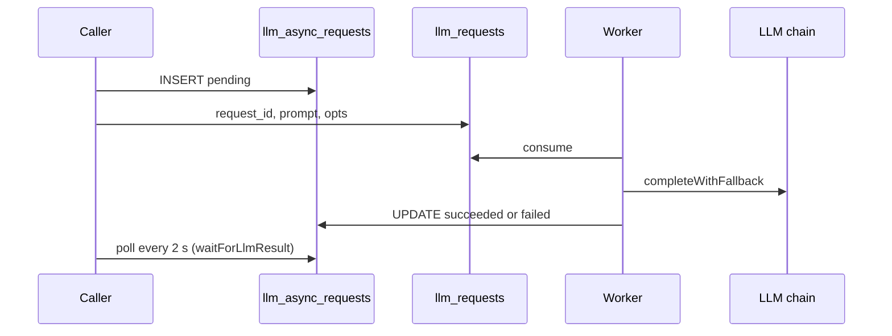

The `llm_requests` queue lets a caller run a slow LLM call without holding a connection. The caller inserts a row, publishes the prompt, and polls the row for the result.

## What are the helper functions?

| Function | Purpose |
|---|---|
| `requestLlmAsync(prompt, opts)` | Inserts the `pending` row, publishes, and returns `{request_id}` immediately. |
| `getLlmRequestResult(id)` | One poll of the row. Returns `null` for an unknown id. |
| `waitForLlmResult(id, {timeoutMs, pollIntervalMs})` | Polls until the row leaves `pending`. Defaults: 120 s timeout, 2 s interval. |
| `processAsyncLlmRequest(payload)` | The queue consumer. |

## What does the result row hold?

| Column | When set |
|---|---|
| `status` | `pending`, then `succeeded` or `failed`. |
| `result_text`, `provider`, `model` | On success. |
| `error_message` | On failure. |
| `completed_at` | On either. |

The result updates are not best-effort. A swallowed failure would leave a caller polling a row that never completes.

## What can go wrong?

| Failure | Result |
|---|---|
| `request_id` or `prompt` missing | `PermanentError`, discarded |
| Every provider fails | Row marked `failed`, then the error is rethrown and the message requeues |
| Caller waits too long | `waitForLlmResult` throws. The row still completes later. |

## Related

- [Message contracts](../message-contracts.md)
- [Rumor digest](rumor-digest.md)
