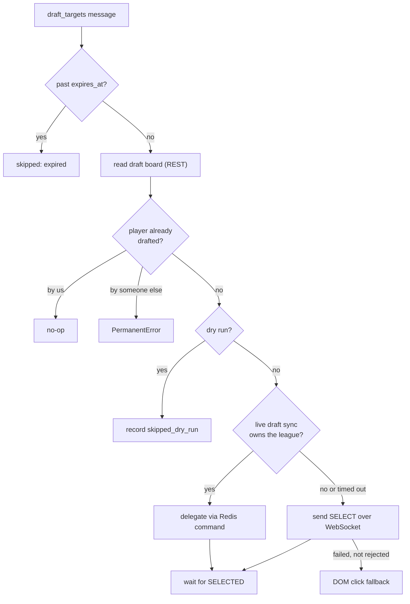

The draft clicker makes one pick in the ESPN draft room. It prefers handing the pick to the live [draft sync](draft-sync.md) session, because a second connection for the same team evicts the first.

## What starts it?

The draft-day optimizer calls the core API's `POST /v1/trigger/draft-pick`. The API checks that the pick slot is still open and unexpired, stores the action, and publishes to `draft_targets`.

## What does the message contain?

| Field | Required | Notes |
|---|---|---|
| `tracking_id` | No | Message identity. |
| `team_id` | Yes | Numeric string. |
| `player_id` | Yes | ESPN id. A negative id is a D/ST. |
| `name` | Yes | Display name, for logs and delegation. |
| `position`, `pro_team` | Sent by core | For a name match against ESPN's player pool. |
| `league_id` | No | Preferred over `ESPN_LEAGUE_ID`, so a practice room is not mistaken for the live league. |
| `pick_number` | No | Forwarded to the rejection notice. |
| `expires_at` | No | Unix seconds. Past it, the worker skips the message. |
| `mode` | No | `live` or `practice`. A practice pick defaults to a real submit. |
| `idempotency_key`, `traceparent` | No | Forwarded on a rejection notice. |

## What does it read and write?

| Step | Surface |
|---|---|
| Read the board | ESPN REST `mDraftDetail` through `readDraftPicks` |
| Check ownership | Redis `draft:{leagueId}:health` lease |
| Delegate | Redis stream `draft_commands:{leagueId}`, result on `draft_commands:{leagueId}:results` |
| Submit | `SELECT <playerId>` frame on the draft-room WebSocket |
| Fallback | A separate Chromium click on the draft board |

The WebSocket protocol is in the [draft room notes](../espn/draft-room.md).

## How does it verify?

The bot waits up to 5 s for ESPN's `SELECTED` frame for the same player and team. A matching frame is recorded as a `draft_pick_click` row in `execution_log` with `status: "success"`. The core API reads that row back for the draft status.

## What can go wrong?

| Failure | Result |
|---|---|
| Missing or non-numeric `team_id`, `player_id` or `name` | `PermanentError` |
| Player drafted by another team | `PermanentError` |
| ESPN sends an `ERROR` frame for the pick | `PermanentError`. The bot also publishes a pick-rejection notice on Redis so core can try the next candidate within the same pick clock. |
| No `SELECTED` within 5 s on both the socket and the DOM fallback | Plain `Error`, requeued. The third consecutive timeout for the same target becomes a `PermanentError`, because the room is gone. |
| Cookies rejected | `SessionExpiredError` |
| League not found (HTTP 404) | `PermanentError` |
| Redis delegation fails | Falls back to a direct session |

`DRY_RUN` defaults to **dry run**. A dry run still writes a `skipped_dry_run` row so the draft status shows it. A `practice` message defaults to live, and an explicit `DRY_RUN` always wins.

## Related

- [Draft sync](draft-sync.md)
- [Message contracts](../message-contracts.md)
