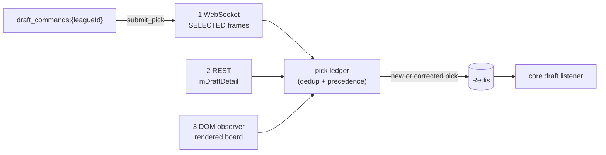

Draft sync is a long-running connector for one league's draft. It records every pick, whoever made it, and publishes them to Redis for the core pipeline's draft listener. It never writes to ESPN, except when it executes a pick the [draft clicker](draft-clicker.md) delegates to it.

## What starts it?

The core API creates a Kubernetes Job for each draft, live or practice. The Job runs `node src/bots/draft_sync.js` and stops when the draft finishes or it gives up. It is not a queue consumer.

| Variable | Purpose |
|---|---|
| `ESPN_LEAGUE_ID`, `ESPN_TEAM_ID`, `CURRENT_YEAR` | Which draft to join. |
| `DRAFT_MODE` | `mock` tries to start a practice draft itself. |
| `DRAFT_ROOM_URL` | An already-open practice room URL. Takes priority over `DRAFT_MODE`. Use it for tests only. |
| `DRAFT_HEALTH_INTERVAL_MS` | Health heartbeat cadence. Default 10 000. |
| `DRAFT_PICK_SILENCE_WARN_MS` | Warn when no new pick arrives for this long. Default 180 000. |
| `DRAFT_STALL_TERMINAL_CYCLES` | Reconnect cycles with no picks before the log escalates to an error. Default 3. |
| `DRAFT_COMMAND_POLL_INTERVAL_MS` | How often it polls for delegated picks. Default 1 000. |
| `DRAFT_COMMAND_CONFIRM_TIMEOUT_MS` | How long it waits for ESPN to confirm a delegated pick. Default 5 000. |

## Why three ingest tiers?

The draft room allows one session per league, team and member. A second connection evicts the first, and the protocol has no replay.

| Tier | Strength | Weakness |
|---|---|---|
| WebSocket | Fastest, exact ids | Misses every pick while evicted. |
| REST | Authoritative, has pick and round numbers | Returns zero picks during a practice draft. |
| DOM observer | Always shows the full board | Slower. Its selectors are unverified. |

The pick ledger collapses overlapping observations into one publish plus later corrections. Source precedence is REST, then DOM, then init, then WebSocket. Identity is the player id, not the pick number.

## What does it write to Redis?

| Key or channel | Type | Content |
|---|---|---|
| `draft_picks:{leagueId}:{seasonId}` | Stream | Each pick as `payload` JSON. |
| `draft:{leagueId}:{seasonId}:picks` | Hash | Pick number to pick JSON. Rehydrated on restart. |
| `draft_picks` | Pub/sub | Each new or corrected pick. |
| `draft:{leagueId}:health` | String, 1 h TTL | Per-tier counters, last pick time, WebSocket state and the ownership lease. |
| `draft:{leagueId}:connected` | String, 60 s TTL | Liveness flag. |
| `draft:{leagueId}:selecting` | String | Whose turn it is and the clock, from `SELECTING` and `CLOCK` frames. |
| `draft:{leagueId}:suggested` | String | ESPN's own suggested pick from `AUTOSUGGEST`. |
| `draft:{leagueId}:autodraft` | String | Autodraft toggles. |
| `draft_commands:{leagueId}` | Stream | Read side: picks delegated by the clicker. |
| `draft_commands:{leagueId}:results` | Pub/sub | Write side: result of each delegated pick. |

## How does it recover?

| Condition | Behavior |
|---|---|
| Socket closes | ESPN reconnects on its own. The sync restarts the browser only after 30 s with no open socket. |
| Reconnect cycle with no new picks | Retries with backoff (2 s doubling to 30 s), up to 10 attempts. |
| Draft finished | Exits 0. Silence alone is never treated as proof of completion. |
| Room confirmed gone | `PermanentError`, no retries. |
| Attempts exhausted | Exits 1 with an error. |

REST also reconciles every 15 s. SIGTERM exits immediately so the core API can tear the Job down.

## Related

- [Draft clicker](draft-clicker.md)
- [Mock draft helper](mock-draft.md)
- [ESPN reverse-engineering notes](../espn-reverse-engineering.md)
