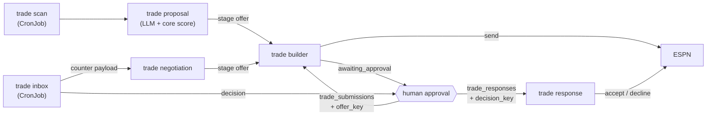

Each bot has its own page covering its trigger, message schema, ESPN reads and writes, verification and failure modes. Find yours in the table.

## Which bot handles what?

| Bot | Starts from | File | Writes to ESPN? |
|---|---|---|---|
| [Lineup](lineup.md) | `lineup_updates` | `lineup_bot.js` | Yes |
| [Waiver sniper](waiver-sniper.md) | `waiver_actions` | `waiver_sniper.js` | Yes |
| [Draft clicker](draft-clicker.md) | `draft_targets` | `draft_clicker.js` | Yes |
| [Draft sync](draft-sync.md) | A Job the core API creates | `draft_sync.js` | No |
| [Trade evaluation and negotiation](trade-evaluation-and-negotiation.md) | `trade_evaluations`, `trade_negotiations` | `trade_bot.js` | Staging only |
| [Trade proposal and scan](trade-proposal-and-scan.md) | `trade_proposals`, `trade-scan` CronJob | `trade_proposal.js`, `trade_scan.js` | Staging only |
| [Trade builder](trade-builder.md) | `trade_submissions` | `trade_builder.js` | Yes, with approval |
| [Trade inbox](trade-inbox.md) | `trade-inbox` CronJob | `trade_inbox.js` | No |
| [Trade response](trade-response.md) | `trade_responses` | `trade_response.js` | Yes, with approval |
| [Rumor digest](rumor-digest.md) | `rumor-digest-bot` CronJob | `rumor_digest_bot.js` | No |
| [Async LLM requests](async-llm-requests.md) | `llm_requests` | `llm_async_queue.js` | No |
| [Session health check](session-health.md) | `espn-session-healthcheck` CronJob | `check_espn_session.js` | No |
| [Mock draft helper](mock-draft.md) | Called by draft sync | `mock_draft.js` | No |

## How do the trade bots fit together?

Offers move from generation through human approval to ESPN. No LLM output reaches ESPN without a person approving the exact offer.

## Tools that are not bots

These files are run by hand and are not part of the production pipeline.

| File | Purpose |
|---|---|
| `draft_recon.js`, `lineup_recon.js`, `waiver_recon.js`, `trade_recon.js` | Capture what ESPN actually sends so request shapes and selectors can be verified. `trade_recon.js` blocks every ESPN write. See [Recon tools](../espn/recon-tools.md). |
| `remote_login.js` | Interactive ESPN login over VNC, run in a Kubernetes Job. See [Session and auth](../espn/session-and-auth.md#refreshing-the-login-remotely). |
| `debug_capture.js` | Saves the latest page HTML and screenshot for any bot that holds a page. |

## Related

- [How bots run](../how-bots-run.md)
- [Message contracts](../message-contracts.md)
