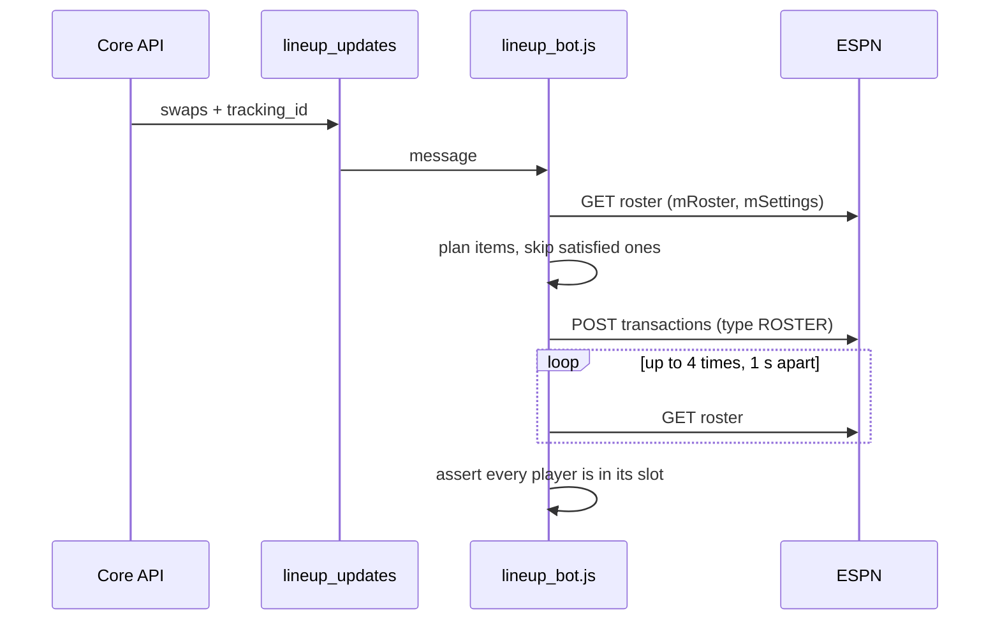

The lineup bot applies the swaps the lineup optimizer chose, as one ESPN roster transaction. It reads your roster first and skips any change that has already landed.

## What starts it?

The core API's `POST /v1/trigger/lineup` stores the action, then publishes to `lineup_updates`. The weekly lineup solver and the web UI both call it.

## What does the message contain?

| Field | Type | Notes |
|---|---|---|
| `tracking_id` | string | Identity of the action. |
| `team_id` | string | Required. |
| `optimized_swaps[]` | array | An empty array is a no-op. |

Each entry is either a swap or an IR move.

| Entry | Fields | Effect |
|---|---|---|
| Swap (no `kind`) | `drop_player_id`, `add_player_id`, `slot` | Moves the dropped player to the bench and the added player into `slot`. |
| `kind: "ir"` | `player_id`, `slot: "IR"` | Moves a player into IR. |
| `kind: "activate_ir"` | `player_id`, `slot` (not IR, usually `BENCH`) | Moves a player out of IR. |
| `kind: "move"` | `player_id`, `slot` (not IR) | Moves a starter to another slot and benches nobody. The producer sends it after a swap whose add can only start in a slot a kept starter holds, so that starter moves into the slot the dropped player left. |

The bot sends the items in an order that never puts a starting slot over capacity: a swap that starts an RB in `FLEX` plus a `move` of the `FLEX` WR into a WR slot goes bench WR, move WR, start RB. Capacity is checked on the end state either way.

Slot names such as `RB1` and `RB2` both resolve to the ESPN `RB` slot. Player ids must be ESPN ids.

## What does it read and write on ESPN?

| Direction | Request |
|---|---|
| Read | `GET` league `mRoster`/`mSettings` views on `lm-api-reads.fantasy.espn.com` |
| Write | `POST …/transactions/` on `lm-api-writes.fantasy.espn.com` with `type: "ROSTER"` and one `LINEUP` item per move |

## How does it verify?

After the write it re-reads the roster up to 4 times, 1 s apart, until every moved player sits in the intended slot. If a player is still wrong after the last read, the bot throws a plain `Error` and the message requeues. The retry finds the work done and succeeds.

The bot plans before it checks the lineup lock. A redelivery after a successful submit therefore completes instead of failing on a lock that appeared in between.

## What can go wrong?

| Failure | Result |
|---|---|
| Missing `team_id`, unknown slot, bad player id, or `ESPN_LEAGUE_ID` unset | `PermanentError`, discarded |
| A player appears in two swaps, or a swap overfills a slot | `PermanentError` |
| Empty roster (draft not held yet) | `PermanentError` |
| Lineup or roster locked by ESPN | `PermanentError`, because the week's optimization is moot |
| An IR move for a player ESPN won't accept (for example an active player) | ESPN rejects the request. See the [IR notes](../espn/transactions.md#ir-moves). |
| Verification fails after four reads | Plain `Error`, requeued |
| Session cookies rejected | `SessionExpiredError`, requeued after 30 s |

On failure the bot writes the roster, the plan and the error to `DEBUG_OUTPUT_DIR` (default `recon-output/`).

`DRY_RUN` defaults to **live** for this bot. Set `DRY_RUN=true` to plan and log without sending.

## Related

- [Message contracts](../message-contracts.md)
- [How bots run](../how-bots-run.md)
