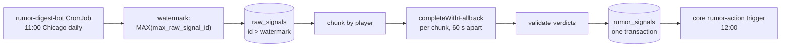

The rumor digest reads new `raw_signals` rows, asks an LLM for one verdict per player, and stores them in `rumor_signals`. It is advisory only. It never touches ESPN and runs no browser.

## What starts it?

The `rumor-digest-bot` CronJob runs `node src/bots/rumor_digest_bot.js` daily at 11:00 America/Chicago, an hour before core's rumor-action trigger. It needs the database and LLM keys but no ESPN cookies.

## What does it read and write?

| Direction | Table | Detail |
|---|---|---|
| Read | `raw_signals` | Rows with `id` above the watermark and a matched `player_id`. The id is core's internal (Sleeper) id, not ESPN's. |
| Write | `rumor_signals` | `player_id`, `sentiment`, `confidence`, `suggested_action`, `source_raw_signal_ids`, `max_raw_signal_id`. |

The watermark is the highest `max_raw_signal_id` already stored. Every verdict in a run, including `no_op`, carries that run's maximum id, so the watermark advances without a separate state table.

## What does the LLM return?

One object per distinct player, in strict JSON.

| Field | Allowed values |
|---|---|
| `sentiment` | `positive`, `negative`, `neutral` |
| `confidence` | A number from 0 to 1 |
| `suggested_action` | `boost_waiver_priority`, `bench_watch`, `no_op` |

The parser drops an entry with an unknown player, a duplicate player, or an invalid field, and logs a warning. It throws only when the response isn't a JSON array.

## How are large batches handled?

| Setting | Default | Purpose |
|---|---|---|
| `RUMOR_DIGEST_CHUNK_SIZE` | 20 players | Largest chunk per LLM call. |
| `RUMOR_DIGEST_TOKEN_BUDGET` | 6 000 tokens | Estimated prompt size per chunk (about 4 characters per token). |
| `RUMOR_DIGEST_CHUNK_DELAY_MS` | 60 000 | Pause between chunks to stay under per-minute provider limits. |

All of a player's rows stay in one chunk.

## What can go wrong?

| Failure | Result |
|---|---|
| No new rows | Logs and exits without an LLM call. |
| Any chunk fails | The whole run fails and nothing is stored. The watermark doesn't move, so the next run retries. |
| Database write fails | The error propagates. The transaction rolls back. |

## Related

- [Async LLM requests](async-llm-requests.md)
- [Telemetry](../telemetry.md)
