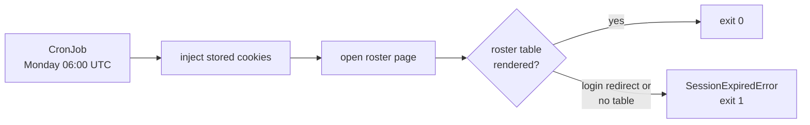

ESPN cookies expire, and the login form can't be scripted. The session health check finds a dead session before a draft or matchup does, so you can re-extract the cookies by hand.

## What starts it?

The `espn-session-healthcheck` CronJob runs `node src/bots/check_espn_session.js` every Monday at 06:00 UTC. A failed Job is the alert. The deadline is 3600 s and `backoffLimit` is 1.

## What does it check?

| Tier | Function | Needs a browser? | Used by |
|---|---|---|---|
| Cookie and REST | `assertCookieSessionValid` | No | Draft clicker, before any authenticated call. |
| Rendered page | `assertRenderedSessionValid` | Yes | This CronJob. |

## What does each failure mean?

| Condition | Error | Retried? |
|---|---|---|
| HTTP 401 or 403 | `SessionExpiredError` | Yes, after 30 s |
| Redirect to a login page, or no roster table | `SessionExpiredError` | Yes |
| HTTP 404 for the league | `PermanentError`. The room or league is gone. | No |
| Other non-2xx status | Plain `Error`. The session isn't treated as expired. | Yes |

## How do I fix an expired session?

Re-extract `espn_s2` and `SWID` from a logged-in browser and update the secret the cluster reads. The error message prints the exact `bao kv put` command. Don't commit the values anywhere.

## Related

- [ESPN reverse-engineering notes](../espn-reverse-engineering.md)
- [How bots run](../how-bots-run.md)
