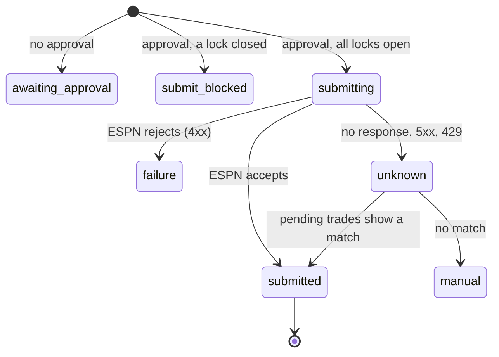

The trade builder fills ESPN's "Propose Trade" form for an offer. It sends the offer only when every lock is open. With any lock closed it ticks the boxes, verifies them, screenshots them and stops.

:::danger[This sends real offers to other managers]
A live send needs `TRADE_DRY_RUN=false` (or `DRY_RUN=false` when `TRADE_DRY_RUN` is unset), `TRADE_SUBMIT_ENABLED=true`, an approval whose `offer_key` matches the offer, verified selectors, and verified counter linkage for a counter. An approval can't be reused for a different offer.
:::

## What starts it?

| Source | Route |
|---|---|
| A generated proposal or counter | The worker calls `submitTradeOffer` itself and stages with no approval. |
| A human approves a staged offer | The core API publishes `trade_submissions` with the approval. |
| A manual run | `node src/bots/trade_builder.js '<json>'` |

## What does the message contain?

| Field | Required | Notes |
|---|---|---|
| `season` | Yes | Integer. |
| `to_team_id` | Yes | The other manager's team. Can't be our own. |
| `incoming_player_ids`, `outgoing_player_ids` | Yes | Non-empty ESPN ids, no duplicates, no overlap. |
| `source` | No | `counter_offer`, `proposal` or `manual`. Default `manual`. |
| `message` | No | A note to the manager. Part of the key. |
| `related_transaction_id` | No | The incoming offer this counters. Part of the key. |
| `thread_root_id` | No | Tracing only. Needs `related_transaction_id`. |
| `approval` | No | `{offer_key, approved_by}`. Without it the run is a dry fill. |
| `tracking_id` | No | |

League and our team come from `ESPN_LEAGUE_ID` and `ESPN_TEAM_ID`.

## What are the locks?

| # | Lock | Open when |
|---|---|---|
| 1 | `TRADE_DRY_RUN`, falling back to `DRY_RUN` | Explicitly `false` (`0`, `false` or `no`). `TRADE_DRY_RUN` wins when set, so `TRADE_DRY_RUN=true` blocks a send even if `DRY_RUN=false`. When both are unset the lock is closed. |
| 2 | `TRADE_SUBMIT_ENABLED` | `true`, `1` or `yes`. |
| 3 | Approval | `offer_key` equals the key recomputed from the offer. |
| 4 | Selectors | Every submit selector is listed under `_verified` in `espn_selectors.json`. |
| 5 | Counter linkage | Only for a counter: `COUNTER_LINKAGE_VERIFIED` is set in `espn_api.js`. |

Set `TRADE_DRY_RUN=false` to arm trade submissions without arming the other bots: it affects only the trade builder, while waiver sniper, draft clicker, lineup and trade response keep reading `DRY_RUN`. The other locks still apply. The closed-lock message names the variable that decided: `TRADE_DRY_RUN is not explicitly false`, `DRY_RUN is not explicitly false (TRADE_DRY_RUN unset)`, or `TRADE_DRY_RUN and DRY_RUN are unset (dry run by default)`. The "ready for approval" push notification gets its `[dry run]` prefix from the same trade switch.

The `offer_key` is a SHA-256 over league, season, both teams, the sorted id lists, the note and the related transaction. Reordering ids doesn't change it. Editing the note does.

## What does it read and write on ESPN?

| Step | Surface |
|---|---|
| Read rosters and pending trades | REST |
| Fill the form | Chromium on `…/football/team/trade?teamId=<them>&fromTeamId=<us>` |
| Send | The final click posts a `TRADE_PROPOSAL` transaction |

A browser-wide guard aborts every non-GET ESPN request until the instant before the final click.

## How does it verify?

- Rows are matched by player headshot id, falling back to name. Anything that isn't exactly one row fails closed.
- A freshly restored ESPN session ignores selection clicks for roughly its first 20 seconds. When a box stays unchecked after the quick retries, the builder waits, reloads the trade builder page, re-resolves every row and fills again from scratch (a reload clears every tick). Backoffs are 5 s, 10 s and 15 s, and no further backoff is spent once the session is older than 45 s. The write guard sits on the browser context, so it stays installed across reloads, and the claim and the send click only happen after the fill returns.
- After ticking, the count of checked boxes must equal the requested count.
- The result's `messageAttached` says whether ESPN's form had a note field. If not, the note isn't sent.
- A real send is claimed in `execution_log` under an advisory lock keyed on `offer_key` before the click. A redelivery of a `submitted` offer is a no-op.
- When the click's outcome is unknown, or a redelivery finds a row stuck at `submitting`, the bot reads ESPN's pending trades. An exact match settles it as submitted. Anything else is a `PermanentError` for a person to check. It never re-clicks on a guess.

## What can go wrong?

| Failure | Result |
|---|---|
| Malformed offer, own team as target, approval for a different offer | `PermanentError` |
| A row doesn't resolve to exactly one player, or a box doesn't stay ticked | `PermanentError` |
| A box doesn't toggle after the click, on every one of 3 attempts (300 ms apart), on every one of 4 full fills (initial plus reloads after 5 s, 10 s and 15 s backoffs, each retry logging a warning with the session's age) | `PermanentError` classified `espn_selection_rejected`, with ESPN's reason or `unknown`. The row's HTML and the reason are logged at error level and stored in the failure row. See [Trade proposal and scan](trade-proposal-and-scan.md). |
| ESPN rejects with 4xx | `PermanentError`, claim marked `failure` |
| ESPN returns 5xx or 429, or no response | Outcome unknown, reconciled as above |
| Claimed but never clicked | Claim released so a retry can run |

## Related

- [Trade proposal and scan](trade-proposal-and-scan.md)
- [Trade evaluation and negotiation](trade-evaluation-and-negotiation.md)
- [ESPN trades](../espn/trades.md)
