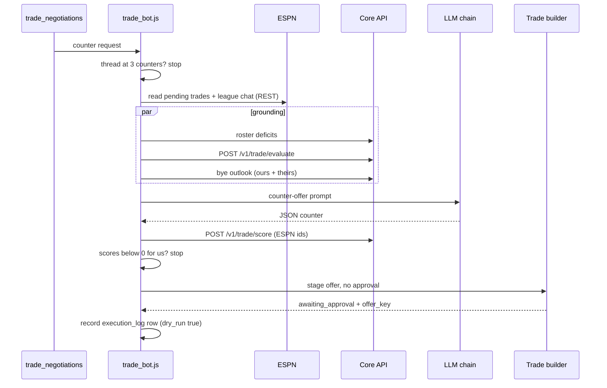

`trade_bot.js` has two queue entrypoints. Evaluation scores a trade and logs the result. Negotiation asks an LLM for a counter-offer and stages it. Neither sends anything to another manager.

## What starts them?

| Queue | Producer | Bot function |
|---|---|---|
| `trade_evaluations` | No scheduled producer. Callers publish it by hand. | `executeTradeEvaluation` |
| `trade_negotiations` | The core API, when a human asks to counter an inbox offer. The trade inbox CLI also prints a payload. | `negotiateTradeProposal` |

## What do the messages contain?

| Field | Evaluation | Negotiation | Notes |
|---|---|---|---|
| `incoming_player_ids` | Required | Required | Non-empty strings. Core's internal ids, not ESPN's. |
| `outgoing_player_ids` | Required | Required | Non-empty, with no id on both sides. |
| `season`, `week` | Required | Required | Integers. |
| `offering_team_id` | | Required | The ESPN team that made the offer. |
| `related_transaction_id` | | Optional | The ESPN offer being countered. |
| `thread_root_id` | | Optional | First offer of the thread. Needs `related_transaction_id`. |
| `tracking_id` | Optional | Optional | |

## What does it call?

| Service | Call | Timeout |
|---|---|---|
| Core API | `POST /v1/trade/evaluate`, then roster deficits | `TRADE_EVALUATE_TIMEOUT_MS`, default 10 s |
| Core API | `GET /v1/roster/bye-outlook` for both teams (best-effort) and `POST /v1/trade/score` for the counter | `TRADE_CONTEXT_TIMEOUT_MS` / `TRADE_SCORE_TIMEOUT_MS`, default 30 s |
| ESPN | Pending trades and league chat, both `GET` | |
| LLM | `completeWithFallback`, in the order set by `LLM_PROVIDER_PRIORITY` | `LLM_REQUEST_TIMEOUT_MS` |

The prompt names players only. ESPN ids never enter it, because they collide with core's internal ids and could come back naming a different player. After the LLM answers, the bot maps the counter's ids to ESPN ids before staging.

The prompt also includes both teams' NFL bye outlooks: who is on bye in the coming weeks, and each team's crunch weeks, where byes leave a starter seat empty or force a below-replacement starter. The model is told to cover our crunch weeks, to use the other team's crunch weeks as leverage, and never to trade a player away over a single bye.

## How does it verify and finish?

- It scores the counter with core's horizon trade score, which counts every bye week. If the score is below zero for us (`final_score`, or `our_lineup_gain` when `final_score` is unavailable), the counter isn't staged and the result carries `submission.status: "rejected_by_score"`. If core can't score the counter, it is staged as before, for a human to review.
- It stages the counter with the [trade builder](trade-builder.md) and no approval. The builder fills the form, checks the ticked boxes and screenshots them, then stops before sending.
- It writes a `trade_negotiation` row to `execution_log` with `dry_run: true`, the counter and the thread linkage.
- A staging failure doesn't fail the message. Retrying would repeat the LLM call for a counter that already exists. The result carries `submission.status: "fill_failed"`.

A thread allows at most 3 of our counters (`MAX_COUNTERS_PER_THREAD`). A fourth is a `PermanentError`.

## What can go wrong?

| Failure | Result |
|---|---|
| Bad ids, overlapping sides, missing `offering_team_id` or `season`/`week` | `PermanentError` |
| Core answers 4xx other than 429 | `PermanentError` |
| Core 429 or 5xx, session failure, LLM fails or returns non-JSON | Plain `Error`, requeued after 5 s |
| Thread already has 3 counters from us | `PermanentError` |

## Related

- [Trade builder](trade-builder.md)
- [Trade inbox](trade-inbox.md)
- [Message contracts](../message-contracts.md)
