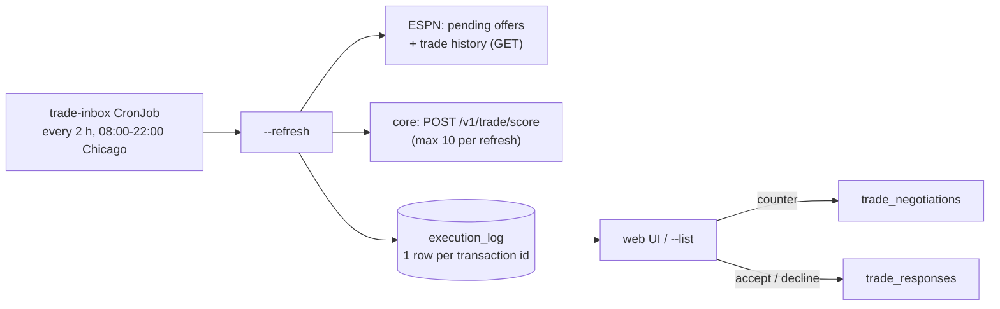

The trade inbox reads every pending offer sent to your team, scores each with core's deterministic scorer, and stores one ranked row per offer. It never writes to ESPN and uses no LLM.

## What starts it?

The `trade-inbox` CronJob runs `node src/bots/trade_inbox.js --refresh` every two hours from 08:00 to 22:00 America/Chicago. It has a 660 s deadline and no retries.

## What are the CLI modes?

| Command | Effect |
|---|---|
| `--check` | Read and score, print the ranked inbox, write nothing. |
| `--refresh` | The same, persisted. This is the scheduled job. |
| `--list [--all]` | Print the ranked inbox from the database. |
| `--triage <id> <new\|seen\|snoozed\|dismissed> <you> [snooze-until ISO]` | Set your triage state. |
| `--counter-payload <id>` | Print a `trade_negotiations` payload for a counter. |
| `--thread <id>` | Print the negotiation an offer or counter belongs to. |

## How are offers ranked?

Offers with a numeric `final_score` come first, highest first. Every other offer follows, soonest expiry first. Ties go to the earlier expiry.

| Reason for no score | Meaning |
|---|---|
| `unavailable` | Core couldn't score it, for example when it has no matchup weeks. |
| `unscorable` | One-sided, or involves more than two teams. |
| `stale_ownership` | A player moved since the offer was made. |

When core is down, the last score for the same offer is kept, marked stale and retried on the next refresh. Incomplete horizons, unmapped players, draft-pick or FAAB items and roster-limit overages are flagged but not re-ranked.

## How does an offer's status change?

Each refresh keeps triage and decisions, and rescores only new or changed offers, a new week, or a failed score.

| Status | Set when |
|---|---|
| `accepted`, `accepted_pending_processing`, `declined`, `countered`, `vetoed`, `withdrawn` | The offer left ESPN's pending list and the trade history says why. |
| `expired` | It left the list and its expiration has passed. |
| `closed_unknown` | Two unexplained misses in a row. |

A failed ESPN read changes nothing. `countered` is set only when ESPN itself links a pending offer to the original.

## What is a negotiation thread?

A thread is a chain of their offers and our counters that share the first offer's `thread_root_id`. `--thread` reports the state from the latest turn.

| State | Meaning |
|---|---|
| `awaiting_us` | Their offer is open. |
| `awaiting_them` | Our counter is pending. |
| `agreed`, `rejected`, `expired` | The thread ended that way. |
| `abandoned` | Withdrawn or closed unexplained. |

Nothing queues a counter on its own. A person decides each turn.

## What does the shadow policy do?

`TRADE_INBOX_SHADOW_ACCEPT_MIN_SCORE` and `TRADE_INBOX_SHADOW_DECLINE_MAX_SCORE` (both unset by default) record what a score threshold would do with each offer. Nothing acts on it. It abstains for stale scores, unmapped players, non-player items and roster overages.

## What can go wrong?

| Failure | Result |
|---|---|
| Pending-offer read fails | It throws before anything is written. Offers are retired only after a successful pending read and a successful history read. |
| Core is unavailable | Scores are kept, marked stale and retried. |
| Outside the regular season | Returns `off_season` and writes nothing. |

## Related

- [Trade response](trade-response.md)
- [Trade evaluation and negotiation](trade-evaluation-and-negotiation.md)
