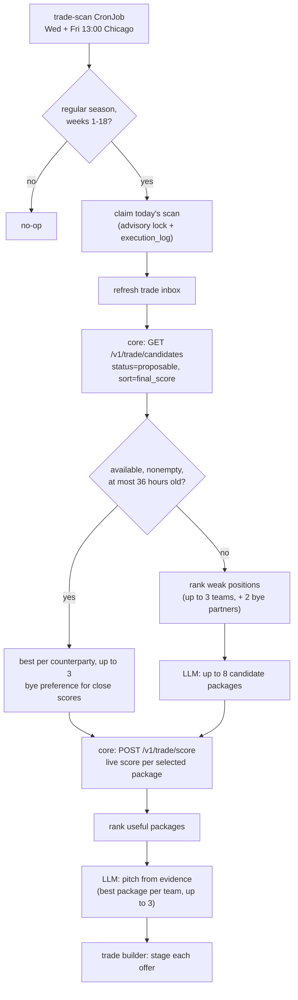

The trade scan CronJob runs the proposal generator twice a week. The generator starts from core’s precomputed proposable candidates, re-scores the selected packages live, and stages the best package for each of up to 3 teams, best first. When candidate data is unavailable, empty or stale, it asks an LLM for packages and scores them with core. A person must approve each one before anything is sent.

## What starts it?

| Path | Use |
|---|---|
| `trade-scan` CronJob runs `node src/bots/trade_scan.js --stage` | Production. Wednesday and Friday at 13:00 America/Chicago. |
| `node src/bots/trade_scan.js --check` | Safe check. Reads the calendar only. No claim, database write, browser or LLM. |
| `trade_proposals` queue | The consumer exists, but there is no KEDA trigger and no producer. Don't use it. |

The Sleeper NFL state API supplies `season` and `week`. Preseason, postseason, week 0 and February to August are successful no-ops. Stale or invalid season data fails closed. This is a calendar gate, not an ESPN trade-deadline check, so suspend the CronJob when trading closes.

## What does the message contain?

| Field | Required | Notes |
|---|---|---|
| `season` | Yes | Integer, 2000 or later. |
| `week` | Yes | Integer, 1 to 18. |
| `exclude_team_ids` | No | Array of ESPN team ids to skip. |
| `tracking_id` | No | |

## How is a package chosen?

The worker first reads `GET /v1/trade/candidates` for the scan’s league, season and week with `status=proposable&sort=final_score`. It reads all pages so repeated packages for one team cannot hide other counterparties. It keeps the highest-ranked stored package for each team and selects up to 3, excluding our team and teams with an open offer to us. Candidates can be selected even when no deficit target exists.

Selection prefers a bye partner when its stored `final_score` is within 5% of the best remaining score. A bye partner has a known bye outlook whose crunch weeks do not overlap ours, and we must have crunch weeks ourselves. Null scores are only close to other null scores. After selection, live scores determine the existing final ranking.

The list’s `computed_at` must be valid and no more than 36 hours old. A 404 (the candidate job has never run), other HTTP/network/JSON errors, empty results, stale data or malformed data use the LLM fallback below. A run changing between pages also triggers fallback. The worker logs `source` (`candidates` or `llm`) and the fallback reason, and stores `ranking.source` in every evaluation.

Each selected candidate is re-scored through `POST /v1/trade/score` using its ESPN send/receive ids and the scan’s period before any pitch is written or offer is staged. An ownership change, unavailable live score or failed eligibility gate skips that alternative. It does not trigger LLM package generation or substitute another snapshot package. On this path, the LLM only writes the grounded pitch.

### LLM package fallback

A position counts as weak when a team is short of starters there, or its `net_vorp` is below the league average for it. The worker keeps the worst weakness on each of up to 3 teams. When our bye outlook has crunch weeks, it adds up to 2 more teams with a weakness whose own crunch weeks miss ours, marked `bye_partner`, so the model sees partners that can spare a starter for our empty weeks.

A package is useful only if all of these hold:

- Our lineup gain is positive.
- The counterparty's lineup doesn't get worse.
- Neither roster goes over its limit.
- Every traded player is mapped.
- At least one horizon week was scored.

The best useful package for each counterparty is staged, up to 3, each with its own pitch and its `rank` in the evaluation. A package whose pitch is rejected or whose evaluation is too large is skipped, and the next one is still staged. Useful packages rank by schedule-weighted `final_score` first, then by value per scored week, then by more scored weeks, a complete horizon and the larger counterparty change. Unscored weeks are unknown, never zero.

The package prompt includes each player's `nfl_bye_week` and the bye outlook (crunch weeks) of our team and of each target team, all from the trade context. The model is asked to prefer packages that cover our crunch weeks, ideally with a partner whose crunch weeks differ from ours, and never to move a player over a single bye. Ranking still uses only core's score, which already counts every bye week of the horizon.

For either package source, the pitch comes from an LLM call that sees only counterparty-facing evidence. That evidence includes any of their bye crunch weeks the trade covers (`bye_coverage.counterparty.fixed`). It must cite evidence ids and may not state a number outside that evidence.

## What does a run return?

| Result | Meaning |
|---|---|
| `no_target` | No candidate counterparty remains after exclusions, or the fallback finds no weak position to target. |
| `no_offer` with a `reason` | `no_packages`, `no_valid_packages`, `no_useful_offer`, `pitch_rejected` or `evaluation_too_large` (the first alternative's reason, when every alternative failed). Nothing is staged. |
| Staged offers | The result keeps the best offer's `target`, `offer`, `evaluation` and `submission` at the top level, and lists every staged one in `offers`. The scan reports `offersStaged`. Each row carries `counter_offer.evaluation` (version `proposal-evaluation-v1`) with the exact live score request, the verbatim live score, the ranking (including `source`) and the pitch. |
| Error | Core couldn't score any package. Nothing is ever staged unscored. |

A staging failure returns `fill_failed` with the computed offer instead of regenerating on a retry. A failure on any alternative fails the CronJob.

## How is a repeat run prevented?

An atomic Postgres advisory lock and a durable `trade_scan_claim` row in `execution_log` allow one attempt per league, team and Chicago calendar date. The claim persists on no-target, no-offer, error and timeout. There are no automatic retries, because a different pitch has a different approval key.

The CLI has a 15-minute hard deadline. The CronJob uses `backoffLimit: 0`, forbids concurrent runs and bounds runtime to 16 minutes.

## What can go wrong?

| Failure | Result |
|---|---|
| Invalid `season`/`week`, or `ESPN_LEAGUE_ID`/`ESPN_TEAM_ID` not a positive id | `PermanentError` |
| Core can't score any package | Error, nothing staged, CronJob exits non-zero |
| LLM or core read failure on the queue path | Delayed retry |
| Same-day second run | Refused by the claim |

## Related

- [Trade builder](trade-builder.md)
- [Trade inbox](trade-inbox.md)
