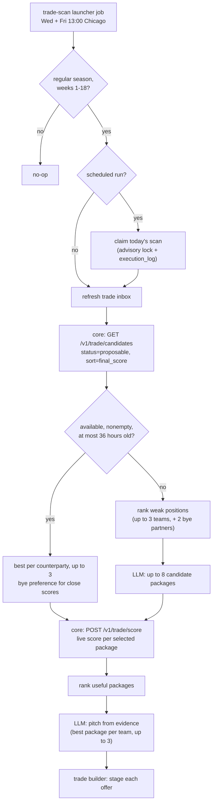

The `trade-scan` launcher job runs the proposal generator twice a week. The generator starts from core’s precomputed proposable candidates, re-scores the selected packages live, and stages the best package for each of up to 3 teams, best first. When candidate data is unavailable, empty or stale, it asks an LLM for packages and scores them with core. A person must approve each one before anything is sent.

## What starts it?

| Path | Use |
|---|---|
| `trade-scan` [launcher job](/overview/job-launcher) runs `node src/bots/trade_scan.js --stage` | Production. Wednesday and Friday at 13:00 America/Chicago. |
| Manual `trade-scan` run from the Jobs page, `python -m src.cli jobs run trade-scan --yes` or the `run_job` MCP tool, or `node src/bots/trade_scan.js --stage` | Skips the daily claim and does not pitch a team with a recent staged offer. |
| `node src/bots/trade_scan.js --check` | Safe check. Reads the calendar only. No claim, database write, browser or LLM. |
| `trade_proposals` queue | The consumer exists, but there is no KEDA trigger and no producer. Don't use it. |

The Sleeper NFL state API supplies `season` and `week`. Preseason, postseason, week 0 and February to August are successful no-ops. Stale or invalid season data fails closed. This is a calendar gate, not an ESPN trade-deadline check, so pause the `trade-scan` job when trading closes, from the Jobs page or with `python -m src.cli jobs pause trade-scan --reason <why>`.

## What does the message contain?

| Field | Required | Notes |
|---|---|---|
| `season` | Yes | Integer, 2000 or later. |
| `week` | Yes | Integer, 1 to 18. |
| `exclude_team_ids` | No | Array of ESPN team ids to skip. |
| `scan_run_id` | No | The scan's own run id. Each staged offer records it. |
| `tracking_id` | No | |

## How is a package chosen?

The worker first reads `GET /v1/trade/candidates` for the scan’s league, season and week with `status=proposable&sort=final_score`. It reads all pages so repeated packages for one team cannot hide other counterparties. It keeps the highest-ranked stored package for each team and selects up to 3, excluding our team and teams with an open offer to us. Candidates can be selected even when no deficit target exists.

Selection prefers a bye partner when its stored `final_score` is within 5% of the best remaining score. A bye partner has a known bye outlook whose crunch weeks do not overlap ours, and we must have crunch weeks ourselves. Null scores are only close to other null scores. After selection, live scores determine the existing final ranking.

The list’s `computed_at` must be valid and no more than 36 hours old. A 404 (the candidate job has never run), other HTTP/network/JSON errors, empty results, stale data or malformed data use the LLM fallback below. A run changing between pages also triggers fallback. The worker logs `source` (`candidates` or `llm`) and the fallback reason, and stores `ranking.source` in every evaluation.

Each selected candidate is re-scored through `POST /v1/trade/score` using its ESPN send/receive ids and the scan’s period before any pitch is written or offer is staged. When a counterparty's best stored package fails its live score or gates (an ownership change, an unavailable score or a failed eligibility gate), the worker tries that counterparty's next-best stored packages, in the stored sort order, at most 2 more. The first survivor is the counterparty's one candidate, and the cap of 3 staged alternatives is unchanged. The evaluation's `ranking.candidate_rank` is the survivor's position among that counterparty's stored candidates (1 is the best, 2 and 3 are runner-ups). A counterparty with no survivor is skipped. Nothing triggers LLM package generation or substitutes another counterparty's package, so when nothing survives the result is `no_offer`. On this path, the LLM only writes the grounded pitch.

### Packages that are already staged or committed

Before scoring, the worker reads our open outgoing offers from `GET /v1/trade/offers` (`awaiting_approval`, `approval_pending`, `approved`, `submitting` and `submitted`, for the scan's league and season). A team with a staged or approval-pending pitch from us in the last 7 days is excluded from the scan. The pitch is rewritten on every scan, so the offer key can't tell that a package is a repeat. Other packages are dropped when:

- `already_staged`: an open offer goes to the same counterparty with the same incoming and outgoing players, ignoring the message and the order of the ids.
- `player_committed`: a player we would send is already in one of our `approval_pending`, `approved`, `submitting` or `submitted` offers. An offer that is only awaiting approval commits nothing, so the same player can still go to another team.

On the candidate path the check runs before each counterparty's best package is chosen, so its next stored package takes the place of a dropped one. On the LLM path the package is simply dropped. A dropped package is not a failure. The run result and run summary list each one under `skipped` / `skippedPackages` (team id, reason and player ids), and each is logged. When every package is dropped the result is `no_offer` with the first reason. If core can't answer the offers read, the scan logs a warning and runs without the check, because a duplicate still needs a person's approval. Once core exposes its committed-player set, the `player_committed` check can read that instead.

### LLM package fallback

A position counts as weak when a team is short of starters there, or its `net_vorp` is below the league average for it. The worker keeps the worst weakness on each of up to 3 teams. When our bye outlook has crunch weeks, it adds up to 2 more teams with a weakness whose own crunch weeks miss ours, marked `bye_partner`, so the model sees partners that can spare a starter for our empty weeks.

A package is useful only if all of these hold:

- Our lineup gain is positive.
- The counterparty's lineup doesn't get worse.
- Neither roster goes over its limit.
- Every traded player is mapped.
- At least one horizon week was scored.

The best useful package for each counterparty is staged, up to 3, each with its own pitch and its `rank` in the evaluation. A package whose pitch is rejected or whose evaluation is too large is skipped, and the next one is still staged. Useful packages rank by schedule-weighted `final_score` first, then by value per scored week, then by more scored weeks, a complete horizon and the larger counterparty change. Unscored weeks are unknown, never zero.

The package prompt includes each player's `nfl_bye_week` and the bye outlook (crunch weeks) of our team and of each target team, all from the trade context. The model is asked to prefer packages that cover our crunch weeks, ideally with a partner whose crunch weeks differ from ours, and never to move a player over a single bye. Ranking still uses only core's score, which already counts every bye week of the horizon.

For either package source, the pitch comes from an LLM call that sees only counterparty-facing evidence. That evidence includes any of their bye crunch weeks the trade covers (`bye_coverage.counterparty.fixed`). It must cite evidence ids and may not state a number outside that evidence.

## What does a run return?

| Result | Meaning |
|---|---|
| `no_target` | No candidate counterparty remains after exclusions, or the fallback finds no weak position to target. |
| `no_offer` with a `reason` | `no_packages`, `no_valid_packages`, `no_useful_offer`, `pitch_rejected`, `evaluation_too_large`, `already_staged` or `player_committed` (the first alternative's reason, when every alternative failed). Nothing is staged. |
| Staged offers | The result keeps the best offer's `target`, `offer`, `evaluation` and `submission` at the top level, and lists every staged one in `offers`. The scan reports `offersStaged` (offers that reached `awaiting_approval`) and `offersFailed`. Each row carries `counter_offer.evaluation` (version `proposal-evaluation-v1`) with the exact live score request, the verbatim live score, the ranking (including `source` and, for candidates, `candidate_rank`) and the pitch. Each row also carries `counter_offer.scan_run_id`, the `run_log` id of the scan that staged it. |
| Error | Core couldn't score any package. Nothing is ever staged unscored. |

## How does a staged offer wait for approval?

Right after the trade builder records an offer as `awaiting_approval`, it opens the offer's *approval run*: a `run_log` row with executor `approval` and status `waiting`, parented to the scan's run, which the Runs tab shows as "waiting for you".

| Field | Value |
|---|---|
| Dedupe key | `approval@<scan run id>#<offer_key>`, so staging the same offer twice in one scan opens one approval |
| `trigger.then` | `{job: trade-submit, params: {offer_key}}`, the run approving it starts |
| `trigger.link` | `/trades?offer=<offer_key>`; the Trades page is where it is approved |
| `trigger.title` | `Send trade to team <id>: give <n>, get <m>` |
| `expires_at` | The next scheduled `trade-scan` (`next_run_at` from core's `GET /v1/jobs`, read once per scan) or 72h after staging, whichever is sooner. If core can't say, 72h. |

The worker writes the row itself (`db/run_log.js` `openApproval`), because worker pods have no API key for core's `POST /v1/runs/{run_id}/approvals`. Core's `tests/test_trade_approval_postgres.py` pins the statement. The only other change the worker makes to an approval is superseding it (below). Core does the rest:

| Event | Approval run | Offer |
|---|---|---|
| Approved on the Trades page | `success` / `approved`; the launcher starts `trade-submit` | `approved` |
| Dismissed on the Trades page | `skipped` / `dismissed` | `dismissed` |
| The next scan replaces it | `skipped` / `superseded` | `dismissed` (`replaced_by_scan`) |
| Past `expires_at` | `skipped` / `expired` | `dismissed` (`dismissed_by: "expired"`) |

A scan outside the launcher (no `RUN_ID`, such as `node src/bots/trade_scan.js --stage` on a laptop) opens no approval runs and logs that once. Its offers, like offers staged before approval runs existed, are approved on the Trades page as before, and core starts `trade-submit` for them directly. Opening is best-effort: if it fails, the offer still stages and is approved the same way.

## What happens to the previous scan's offers?

After a scan stages its offers, it dismisses the `awaiting_approval` proposals earlier scans staged for our team (`status: dismissed`, `outcome_details.dismissal.reason: replaced_by_scan`) and, in the same transaction, supersedes their waiting approval runs. Each key is retired under the same advisory lock core's approval takes, so an approval that lands mid-scan either wins outright or finds the offer already dismissed. A key approved in the meantime is left alone. Counter-offers are not proposals and are never retired. The run summary reports `proposalsRetired`. A failure here is logged and doesn't fail the scan: the old offers stay listed until the next scan, or until they expire.

## What happens after a person approves an offer?

Core starts the `trade-submit` launcher job with the offer's `offer_key`, from the offer's approval run, so the send shows under the scan on the Runs tab. The job runs the [trade builder](trade-builder.md) with `--offer-key`.

## What happens when an offer fails to stage?

Each offer is staged on its own. A failure is recorded on that offer's `submission` (`status: fill_failed`, `error`, a `classification` and, for a refusal, the `reason`), a warning is logged, and the scan carries on with the remaining offers. The computed offer is never regenerated because staging failed.

The scan's result and run summary show `offersStaged`, `offersFailed` and, when any failed, `failures` (team id, classification, reason). The scan exits non-zero only when nothing staged and at least one offer failed, so a partial success doesn't fire the failed-run job alert. `no_target` and `no_offer` are unchanged and never a failure.

### ESPN refusing a selection

ESPN's rows can be rendered before its handlers attach, so the first click can be swallowed with no refusal shown. When Playwright reports that a click did not change the box's state, the worker re-locates the box and retries (3 attempts in all, 300 ms apart), logging a warning for each retry. A freshly restored ESPN session also ignores every selection for roughly its first 20 seconds, which those quick retries cannot outlast, so a box that is still ignored makes the worker wait, reload the trade builder and redo the whole fill (up to 3 reloads, after 5 s, 10 s and 15 s; none once the session is older than 45 s). The scan's single session therefore only pays this wait on its first fill or two, and the added time sits well inside the scan's 15-minute runtime limit. If the box is still unchecked after the last full attempt, the attempt is classified `espn_selection_rejected` rather than treated as a crash. The worker reads what the page shows near that row: `title` and tooltip attributes, `aria-disabled`, disabled or locked state classes, and any visible alert, status, tooltip, toast or error element. The reason is those signals joined together, or `unknown` when the page shows nothing. The signals are generic because the refusal UI hasn't been recorded yet.

For a candidate-sourced offer, the same counterparty's next stored packages (the runner-ups, by `candidate_rank`) are then live-scored, gated and pitched, and staged in its place. The cap is the same as for live-score fallbacks: at most 2 runner-ups per counterparty in total, so at most 3 attempts. Another counterparty's package is never substituted and the LLM never writes a replacement package. The offer that finally staged lists the refused ones in `rejectedAttempts`, and the run summary lists them in `rejectedSelections`. Any other staging error is not retried against runner-ups.

### Where does the failure evidence go?

Debug captures written to `recon-output` are lost with the pod. The Job has no volume for artifacts and the infra repo has no object store or PVC for them. A refused selection is therefore also kept in:

- the pod logs, at error level: the failing row's `outerHTML` (first 2000 characters), the visible error text and the reason.
- the failed offer's `trade_offer_submit` row in `execution_log`, under `counter_offer.failure` (classification, player id, reason, `rowHtml`, `visibleText`).

The screenshot is not persisted. Persisting it would need new storage in the cluster.

## How is a repeat run prevented?

An atomic Postgres advisory lock and a durable `trade_scan_claim` row in `execution_log` allow one scheduled attempt per league, team and Chicago calendar date. Manual scans skip this claim and use the same recent staged-pitch exclusion, so a daily claim does not block an operator run and a second manual scan does not re-pitch a team. The claim persists on no-target, no-offer, error and timeout. There are no automatic retries, because a different pitch has a different approval key.

The CLI has a 15-minute hard deadline. The launcher job has one attempt, forbids concurrent runs (`overlap: forbid`) and bounds runtime to a 16-minute `deadline`.

## What can go wrong?

| Failure | Result |
|---|---|
| Invalid `season`/`week`, or `ESPN_LEAGUE_ID`/`ESPN_TEAM_ID` not a positive id | `PermanentError` |
| Core can't score any package | Error, nothing staged, the run exits non-zero |
| Some offers fail to stage, at least one stages | Success. Counts and failures are in the result and run summary. |
| Every offer fails to stage | `Trade scan staging failed`, the run exits non-zero |
| LLM or core read failure on the queue path | Delayed retry |
| Same-day scheduled run | Refused by the claim |
| Manual run after a scheduled run | Runs without changing the claim; skips teams with a recent staged pitch |

## Related

- [Trade builder](trade-builder.md)
- [Trade inbox](trade-inbox.md)
