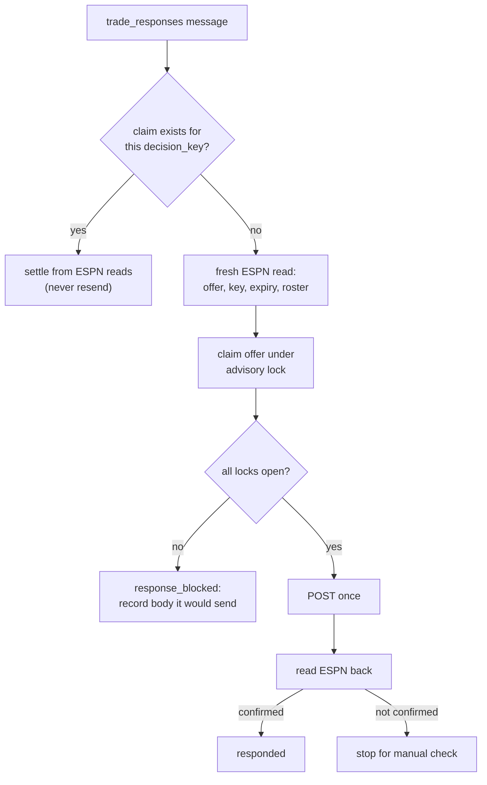

The trade response bot accepts or declines one offer from the [trade inbox](trade-inbox.md). It sends only when every lock is open, and it never sends twice for one offer.

:::danger[This answers real offers and can't be undone]
Accepting moves players on real rosters. The worker refuses unless a person approved the exact action on the exact offer as ESPN shows it now.
:::

## What starts it?

The core API publishes `trade_responses` when a person approves an accept or decline in the inbox. You can also run `node src/bots/trade_response.js '<json>'`.

## What does the message contain?

| Field | Required | Notes |
|---|---|---|
| `espn_transaction_id` | Yes | The offer's ESPN id. |
| `action` | Yes | `accept` or `decline`. |
| `approval` | To send | `{decision_key, approved_by, reviewed_note}`. The key is 64 hex characters. |
| `comment` | No | A note sent with the response. Part of the key. |
| `retry` | No | `{of_claim_id, approved_by, verified_not_answered}`. Needs a new `tracking_id`. |
| `tracking_id` | No | |

`reviewed_note` is the exact proposer note the person reviewed, a string or `null`. It must match ESPN's current note, including whitespace. An empty string differs from `null`.

## What are the locks?

| Lock | Open when |
|---|---|
| `DRY_RUN` | Explicitly `false`. |
| `TRADE_RESPONSE_ENABLED` | `true`, `1` or `yes`. Separate from `TRADE_SUBMIT_ENABLED`. |
| Approval | `decision_key` equals the key recomputed from a fresh read. |
| Verified action | The action is in `VERIFIED_TRADE_RESPONSE_ACTIONS` in `espn_api.js`, which starts empty. |
| Verified shape | `PENDING_TRADE_SHAPE_VERIFIED` is true. |

The `decision_key` is a SHA-256 over league, season, team, transaction id, action, offer fingerprint and note. With any lock closed the bot records `response_blocked` and the body it would have sent.

## When does it always refuse?

- The offer is gone, or expires within 5 minutes.
- The offer isn't open in the inbox, or changed since it was read.
- Another response to the offer is claimed, in progress, settled, unknown or rejected.
- For an accept: the roster is locked, the offer has no current score, or the trade puts us over the roster limit.

## How does it avoid answering twice?

- **Reconcile first.** An existing claim on the key settles from ESPN reads. A responded key returns `duplicate`. A responding or unknown one is read back and never resent.
- **One claim per offer.** The claim row and the entry's `responding` status are written in one transaction under the `trade-inbox:{league}:{transactionId}` lock. An accept and a decline can't both go out.
- **Read back.** After the POST, and after an unknown outcome, ESPN is read again. Only a confirming read settles it. Anything else stops for a manual check in ESPN.

## How do I retry a stuck response?

A response ESPN rejected, or one with an unknown outcome, stays blocked until a person retries it. Send the same approval with a new `tracking_id` and `retry`.

| Previous state | Retry needs |
|---|---|
| Rejected | `retry.of_claim_id` and `approved_by`. |
| Unknown | Also `verified_not_answered: true`, and a fresh read that still shows the offer pending with no related history row. |

If the reads now confirm the earlier response, it is settled instead. The retried row becomes `superseded` in the same transaction as the new claim.

## What can go wrong?

| Failure | Result |
|---|---|
| Missing or wrong fields, mismatched key or note, offer gone or too close to expiry | `PermanentError` |
| ESPN rejects the session | `PermanentError`. Refresh the session and retry from the inbox. |
| ESPN returns 429 or 5xx | Outcome unknown. The claim stays blocked for a human retry. |

## Related

- [Trade inbox](trade-inbox.md)
- [ESPN reverse-engineering notes](../espn-reverse-engineering.md)
