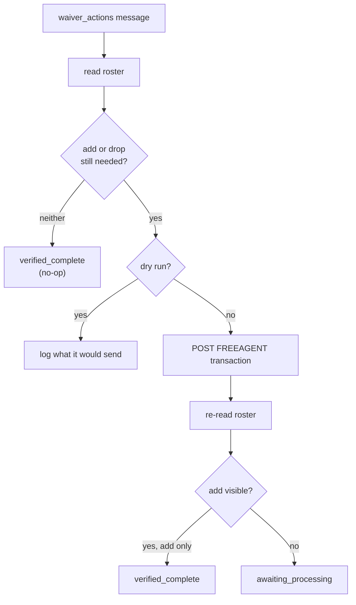

The waiver sniper submits one add, one add-and-drop, or one drop to ESPN. It sends only the half of a claim that is still missing, so a redelivery cannot add a player twice.

## What starts it?

| Producer | Path |
|---|---|
| Waiver evaluator, rumor-action trigger and the web UI | Core API `POST /v1/trigger/waiver` |
| Player sync | Publishes `INJURY_STATUS_CHANGE` alerts straight to `waiver_actions`. These carry `event_type`, `player_id`, `name`, `team`, `new_injury_status` and `timestamp`, not a claim. |

## What does the message contain?

| Field | Required | Notes |
|---|---|---|
| `tracking_id` | No | Falls back to `player_id` in logs. |
| `team_id` | Sent by core | The worker acts on `ESPN_TEAM_ID`. |
| `player_id` | Yes | ESPN id of the free agent to add. Negative ids are D/ST. |
| `name`, `team` | Sent by core | Used for logs. |
| `drop_player_id` | No | ESPN id of the player to drop. Omit for an add-only claim. |
| `dry_run` | No | A boolean overrides `DRY_RUN` for this message. |

## What does it read and write on ESPN?

| Direction | Request |
|---|---|
| Read | League roster views (before and after) |
| Write | `POST …/transactions/` with `type: "FREEAGENT"` and an `ADD` item, a `DROP` item, or both |

## How does it verify?

| Situation | Outcome |
|---|---|
| Add already on the roster and drop already gone | `verified_complete`, nothing sent |
| Add-only claim, add visible after the write | `verified_complete` |
| Claim with a drop, or add not visible yet | `submitted` with `awaiting_processing` |

:::note
In a waiver period ESPN queues the claim. The roster won't show the player until it processes, so a missing player after submit is logged as likely queued, not as a failure.
:::

## What can go wrong?

| Failure | Result |
|---|---|
| Invalid `player_id`, add equals drop, drop not on the roster | `PermanentError` |
| `ESPN_LEAGUE_ID` or `ESPN_TEAM_ID` unset | `PermanentError` |
| HTTP 4xx from ESPN other than 429 | `PermanentError` |
| HTTP 429, 5xx or a network failure | Plain `Error`, requeued |
| Redelivery after the write started | Stops for manual verification. See [How bots run](../how-bots-run.md). |

`DRY_RUN` defaults to **dry run** for this bot. The write shape is only partly verified, so set `DRY_RUN=false` or send `dry_run: false` to submit.

## Related

- [Message contracts](../message-contracts.md)
- [Transactions endpoint](../espn/transactions.md)
