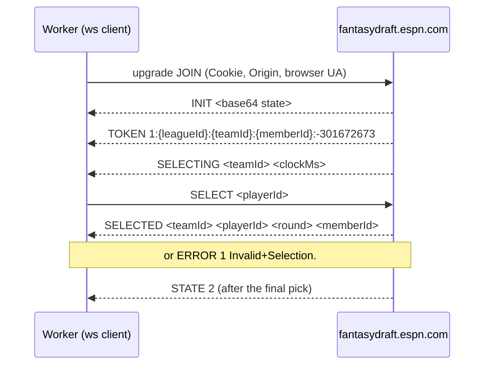
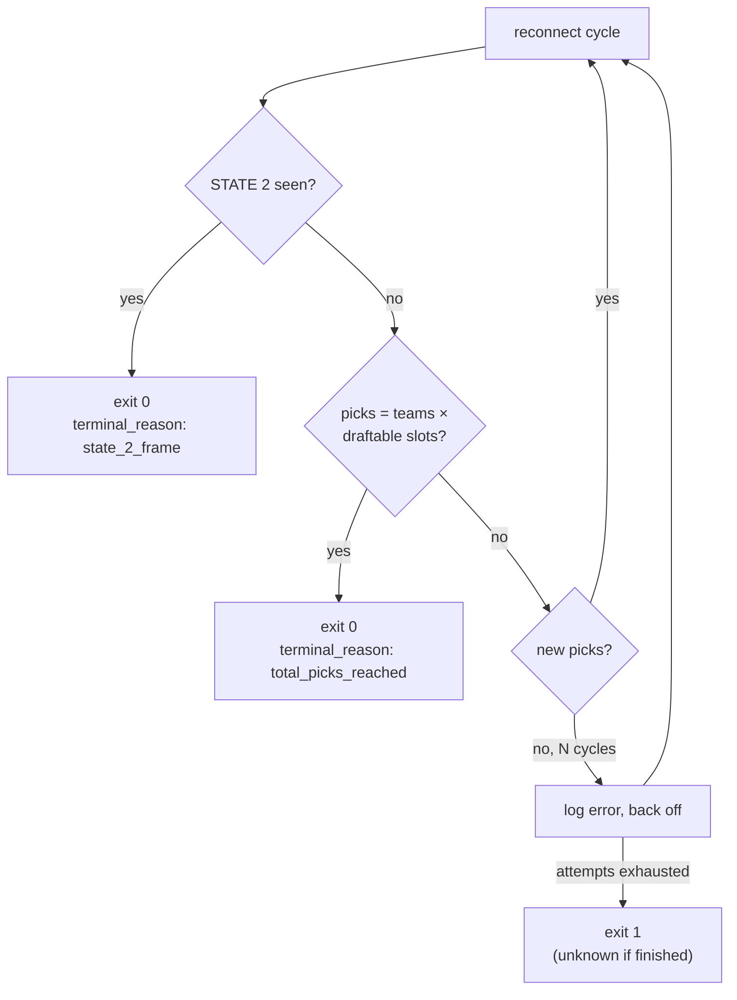

Live drafts run on a separate backend, `wss://fantasydraft.espn.com`, not the REST API. Use this page to join a room, submit a pick, read picks back and tell a finished draft from a dead connection.

:::tip[The short version]
- `SELECT <playerId>` on the joined socket submits a pick. `SELECTED` confirms it in about 250 ms.
- The room is **single-session**: a new JOIN for the same identity evicts the old one, and there is no replay.
- `STATE 2` is ESPN's draft-complete signal.
- Cookies are enough for the socket. The rendered draft room also needs a real login.
:::



## Joining the room

Confirmed live on 08-16 and 08-17.

```text
wss://fantasydraft.espn.com/game-1/league-{leagueId}/JOIN
  ?1=1&2={leagueId}&3={teamId}&4={memberId}&5=1:{leagueId}:{teamId}:{memberId}:-301672673
  &6=false&7=false&8=KONA&nocache={random}
```

| Part | Meaning |
|---|---|
| `{memberId}` | The `SWID` cookie **with its braces** |
| `-301672673` | A fixed constant, identical across leagues and sessions. Not session-derived. |
| `1`, `6`, `7`, `8=KONA` | Literal constants copied from real traffic. Their meaning is unknown. |
| Encoding | `{`, `}` and `:` stay literal. `URLSearchParams` would percent-encode them, so `buildDraftSocketUrl` builds the string by hand. |

The upgrade request needs all three of these headers. A bare `Cookie` got a 403 from the edge before any app response.

| Header | Value |
|---|---|
| `Cookie` | `espn_s2=<espn_s2>; SWID={SWID-WITH-BRACES}` |
| `Origin` | `https://fantasy.espn.com` |
| `User-Agent` | A real desktop browser string |

## Frame reference

All frames are plain text, not JSON.

| Frame | Direction | Meaning |
|---|---|---|
| `INIT <base64>` | server → client | Full draft state, once per connection. 10–20 KB or more. |
| `TOKEN 1:{leagueId}:{teamId}:{memberId}:-301672673` | server → client | Echoes the JOIN token. |
| `STATE <n>` | server → client | `1` at connection start while the draft runs. `2` exactly once, right after the final `SELECTED`. Confirmed 08-25. |
| `CLOCK <slot> <msRemaining> <teamId>` | server → client | Countdown update. |
| `SELECTING <teamId> <clockMs>` | server → client | A team just went on the clock. The reliable "whose turn" signal. |
| `SELECT <playerId>` | client → server | **Submits a pick.** |
| `SELECTED <teamId> <playerId> <round> [<memberId>]` | server → client | A pick landed. `memberId` only when a human picked. Carries a round, not an overall pick number. |
| `ERROR <code> <message>` | server → client | Pick refused. A pick for a drafted player returns `ERROR 1 Invalid+Selection.` (spaces sent as `+`). |
| `AUTOSUGGEST <playerId>` | server → client | ESPN's suggested pick, once per pick cycle. A bare player ID. |
| `AUTODRAFT <teamId> <bool>` | server → client | A team's autodraft toggle changed. |
| `DRAFT_LIST <id> <id> …` | both | The full "queue" list on every change. **Not a pick.** |
| `PING PING%20<unixMs>` | client → server | Keepalive every ~15 s from a browser. Not needed before `SELECT`. |

## Submitting a pick

`SELECT <playerId>\n` on the joined socket. This was verified twice: in a passive capture of a human pick, and by `draft_room_socket.js`'s own `sendPick()` in a real practice draft. Confirmation came back in about 250 ms.

| Outcome | How the worker treats it |
|---|---|
| Matching `SELECTED` | Success |
| `ERROR` frame | `PermanentError`. The player is gone, so a retry can't succeed. A rejection notice also goes to Redis. |
| Nothing within the timeout | Ambiguous. Retried, then permanent after repeated timeouts. |

An HTTP `GET …/game-1/league-{id}/SELECT?1={playerId}&token=…` was seen once in a browser's Network panel. Every pick the worker has sent used the socket alone, so the HTTP form isn't implemented.

## The room is single-session

Confirmed live on 08-17: a new JOIN for the same league, team and member **evicts** the existing connection. The evicted side sees its socket close with no distinguishing code.

| Side effect | Handling |
|---|---|
| A pick evicts the manager's own open browser tab | Recoverable. The pick has already landed when the tab reconnects. |
| A pick evicts the long-running draft sync | Draft sync owns the socket. The clicker delegates picks to it through the session registry instead of joining. See [Session and auth](session-and-auth.md#the-session-registry). |
| A watcher such as `scripts/draft-watch.js` gets evicted | It reconnects with a short backoff. |

## Draft-room DOM

Confirmed live on 08-16 and 08-17. Unlike the roster page, which has no per-player identifier at all, the draft room puts one on its buttons.

| Element | Selector |
|---|---|
| Queue button | `button.Button--queue.action-btn[data-player-id="{playerId}"]` |
| Draft button | `button.Button--draft[data-player-id="{playerId}"]` |

The Draft button only renders while you're on the clock. `draft_recon.js` captures the DOM the instant a `SELECTING` frame names your team.

:::warning[Board selectors are unverified]
The pick-history board has never been captured with picks on it. `draft_dom_observer.js` tries a list of candidate selectors, ending in a structure-free `[data-player-id][data-team-id]` scan, and logs every miss with match counts and a sample of the board HTML. One look at pod logs from a real draft is enough to fix it.
:::

## Reading picks: three tiers

Each source has a blind spot, and the WebSocket and REST tiers fail **together** during a practice draft.

| Tier | Source | Strength | Failure mode |
|---|---|---|---|
| 1 | WebSocket `SELECTED` | Fastest, exact IDs | Misses every pick while evicted. No replay. |
| 2 | REST `mDraftDetail` | Only source of `overallPickNumber` | Zero picks for a whole practice draft. |
| 3 | Rendered board (DOM) | Full history whenever you look | Selector-dependent. Needs a real login. |

All three feed `draft_pick_ledger.js`:
- Precedence is REST, then DOM, then init, then WebSocket. The WebSocket publishes first and higher tiers only correct it.
- The dedup key is **`player_id`**, because a player is drafted once and pick numbers don't agree across sources.
- A pick is committed only after the Redis write lands, so a Redis failure can't mark an unpublished pick as seen.
- On startup the ledger reseeds from `draft:{leagueId}:{seasonId}:picks`, so a restarted pod doesn't republish the whole board.

The [Draft sync](../bots/draft-sync.md) page lists the Redis keys.

## Detecting draft completion

A finished draft looks like a dead connection at the transport layer: REST goes empty and the board disappears. Confirmed live on 08-25, the socket does **not** close when the draft ends. It stays open with only keepalives.



| Signal | Status |
|---|---|
| `STATE 2` frame | Confirmed live. Sent once, right after the final `SELECTED`. |
| Total picks reached | `mSettings` + `mTeam` give teams × draftable slots, **excluding IR slot 21**. One practice league had 17 slots including IR, so 10 × 16 = 160 picks, not 170. Confirmed working mid-draft. After the draft it returns `LEAGUE_NOT_FOUND_DELETED`, so the total learned earlier is kept. |
| N cycles with no picks | **Not** a completion signal. An outage looks the same. It only escalates the log and leads to a failure exit if nothing else fires. |

The heartbeat on `draft:{leagueId}:health` carries `terminal`, `terminal_reason`, `consecutive_empty_cycles` and `expected_total_picks`. Every frame type other than `INIT` and `SELECTED` is counted in `ws.other_frames`, which is how `STATE 2` was found.

## Practice and mock draft quirks

| Quirk | What to do |
|---|---|
| "Practice Draft" sometimes opens the room in a **new tab**. | `startFreshPracticeDraft` races both and returns `{ url, page }`. Use the returned `page`. |
| `getByText(/practice draft/i)` matches a section heading first, and clicking it silently does nothing. | Use `getByRole("button", { name: /practice draft/i })`, which matches only the button. |
| Headless auto-join never navigates, even with the right button. | Invisible reCAPTCHA Enterprise blocks it. Have a human join once and pass `DRAFT_ROOM_URL`. |
| A queued player (`DRAFT_LIST`) looks like a pick. | Only `SELECT` and `SELECTED` are picks. |

<details>
<summary>How the headless auto-join block was traced (08-21)</summary>

1. The lobby always embeds an invisible reCAPTCHA Enterprise iframe next to the Disney identity iframe.
2. Without a permission grant, clicking "Practice Draft" makes that iframe call `document.requestStorageAccess()`. Headless Chromium denies it, and the page's React app crashes.
3. Granting it over raw CDP stops the crash: `Browser.setPermission({ permission: { name: "storage-access" }, setting: "granted", origin: "https://www.google.com", embeddingOrigin: "https://fantasy.espn.com" })`. The name is kebab-case. Playwright's `grantPermissions()` doesn't cover it.
4. Even then, the click never navigates, with `navigator.webdriver` already `false`. A silent no-op is reCAPTCHA Enterprise scoring the session as automated.

More permissions or Chromium flags won't fix this. Don't spend more time on it.

</details>

## Debugging a missing pick

Filter pod logs on `component=`:

| Component | Shows |
|---|---|
| `draft_ws` | Socket open and close with frame and pick counts. A close logs at `warn` because it's usually an eviction. |
| `draft_dom_observer` | Scan results and selector misses with a DOM sample. |
| `draft_ingest` | Every publish, correct or drop decision. "DOM tier recovered N pick(s) the WebSocket never delivered" means the socket is being evicted. |
| `draft_health` | Fixed-cadence heartbeat with `ws_connected`, `picks_known`, `pick_silence_ms` and per-tier counters. It fires even when nothing happens, because silence is ambiguous. |

## Related

- [Draft sync](../bots/draft-sync.md), [Draft clicker](../bots/draft-clicker.md), [Mock draft helper](../bots/mock-draft.md)
- [Session and auth](session-and-auth.md)
