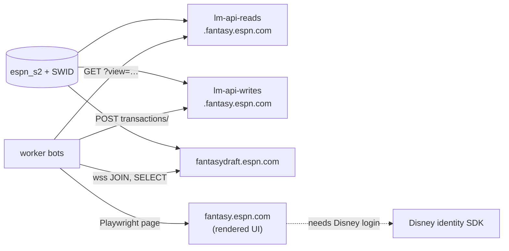

ESPN has no public fantasy API. Everything the worker sends to ESPN comes from captured browser traffic, ESPN's own frontend bundles, or live tests against a real league. This section records what was confirmed, how, and what is still a guess.

:::tip[The short version]
- Reads go to `lm-api-reads`, writes go to `lm-api-writes`, and every write is a POST to one `transactions/` endpoint.
- Drafts use a separate WebSocket backend, `fantasydraft.espn.com`, with plain-text frames.
- The `espn_s2` and `SWID` cookies are enough for REST and the WebSocket. A rendered page also needs a real interactive login.
- A live capture against a real league is always reverted, and every write needs explicit approval.
:::

## Which page do I need?

| I want to… | Read |
|---|---|
| Find the `view=` that returns rosters, settings, pending trades or chat | [Read views](read-views.md) |
| Build a lineup, IR, add or drop request | [Transactions endpoint](transactions.md) |
| Propose, accept, decline or counter a trade | [Trades](trades.md) |
| Join a draft room, submit a pick or detect draft completion | [Draft room](draft-room.md) |
| Decode a `TRAN_*` code or another rejection | [Error codes](error-codes.md) |
| Capture new ESPN traffic without changing the league | [Recon tools](recon-tools.md) |
| Understand cookies, the saved session, remote login and session health | [Session and auth](session-and-auth.md) |

## How confident is each finding?

Each page labels its findings with one of these levels. Dates are when the finding was confirmed, all in 2026.

| Label | Meaning |
|---|---|
| **Confirmed live** | Seen on the wire against a real league or draft, or produced by the worker's own code path and verified. |
| **From the bundle** | Read from ESPN's frontend JavaScript. Nothing was sent. The minified names change between builds. |
| **Unverified** | What the code assumes. A flag in `espn_api.js` usually blocks the write until a capture confirms it. |

## Placeholders

The examples use placeholders only. Replace them with your own values when you run a probe.

| Placeholder | Stands for |
|---|---|
| `{leagueId}`, `1234567890` | Your league ID. Practice drafts get their own ephemeral league ID. |
| `{teamId}`, `8` | Your team's ID within the league. |
| `{SWID-WITH-BRACES}`, `{00000000-0000-0000-0000-000000000000}` | The `SWID` cookie, including its braces. It is also your ESPN `memberId`. |
| `<espn_s2>` | The `espn_s2` cookie. Never paste a real one into a doc, fixture or log. |

Player IDs in examples are ESPN's public player IDs.

## Related

- [Bots](../bots/index.md) lists which bot calls each endpoint.
- [How bots run](../how-bots-run.md) covers `DRY_RUN` and the other write gates.
