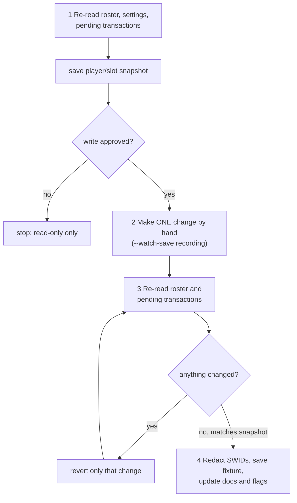

The recon tools capture what ESPN's own UI sends, so request shapes and selectors come from evidence instead of guesses. They are run by hand on a workstation and are not part of the production pipeline. To confirm a new request shape, start here.

:::danger[The live-capture rules]
There is only one real league, so every capture runs against it.
1. **Read-only first.** Exhaust bundle reads, `GET`s and write-guarded page loads before sending anything.
2. **Every write needs explicit approval**, including a write you expect ESPN to reject.
3. **A human clicks; the bot never does.** Recon records traffic while you act in a headed browser.
4. **Every live capture is reverted.** Snapshot first, undo the change, and re-read until the roster matches the snapshot.
5. **Never retry an ambiguous write** before re-reading state.
6. **Cookies stay in memory.** Never put `espn_s2`, `SWID` or a saved session in a capture, fixture, doc or commit.
:::

## Which tool do I use?

| Tool | Captures | Writes possible? | Output in `recon-output/` |
|---|---|---|---|
| `lineup_recon.js` | Team page DOM, selector probe, roster snapshot. With `--watch-save`, every non-GET ESPN XHR and its response. | Yes, if you click Save | `lineup-dom.html`, `lineup-screenshot.png`, `lineup-selector-probe.json`, `lineup-roster-snapshot.json`, `lineup-xhr.jsonl` |
| `waiver_recon.js` | Free-agent page DOM and roster snapshot. With `--watch-save`, every non-GET ESPN XHR. | Yes, if you add or claim | `waiver-dom.html`, `waiver-screenshot.png`, `waiver-roster-snapshot.json`, `waiver-xhr.jsonl` |
| `trade_recon.js` | Trade builder DOM, screenshots and network at each step, plus a per-row dump. | **No.** A write guard aborts every ESPN write. | `trade-recon-latest.log`, `trade-recon-rows.jsonl`, `trade-recon-blocked-writes.jsonl` |
| `draft_recon.js` | Draft room WebSocket frames, HTTP traffic and numbered DOM snapshots, including one the moment you go on the clock. | Only if you pick | `websockets.jsonl`, `http-requests.jsonl`, `http-responses.jsonl`, `dom-snapshot-N.html`, `draft-recon-latest.log` |
| `debug_capture.js` | The latest HTML and screenshot from any bot holding a page. | No | `debug-<label>-latest.html`, `debug-<label>-latest.png` |

`recon-output/` and `.espn-storage-state.json` are gitignored. Playwright's `request.headers()` leaves out cookie headers, so `*-xhr.jsonl` files don't contain cookies. Still check a capture before turning it into a fixture.

## Running a capture

:::info[Prerequisites]
- Node 20 and Playwright Chromium installed (`npm ci`).
- `ESPN_LEAGUE_ID` set. `ESPN_TEAM_ID` defaults to `8` and `CURRENT_YEAR` to `2026`, so set both for your team.
- Cookies in `ESPN_S2` and `SWID`, or an authenticated `bao` CLI. Without either, the tool opens a browser for you to log in.
- Approval for any write you plan to make.
:::

```bash title="Read-only snapshot"
ESPN_LEAGUE_ID={leagueId} ESPN_TEAM_ID={teamId} node src/bots/lineup_recon.js
```

```bash title="Record a save you make by hand"
ESPN_LEAGUE_ID={leagueId} ESPN_TEAM_ID={teamId} node src/bots/lineup_recon.js --watch-save
```

```bash title="Trade builder, writes blocked"
ESPN_LEAGUE_ID={leagueId} ESPN_TEAM_ID={teamId} TRADE_RECON_TO_TEAM_ID=3 node src/bots/trade_recon.js
```

```bash title="Draft room"
node src/bots/draft_recon.js            # start a fresh practice draft from the lobby
node src/bots/draft_recon.js <room-url> # observe a room that's still open
```

`--watch-save` always opens a visible browser. The tool waits for you to press Enter in the terminal once you've acted.

## The capture-and-revert procedure



1. **Pre-check.** Re-read the roster, settings and pending transactions. Confirm the preconditions still hold (for example the player is still a free agent and the roster is unlocked), then save the snapshot. Use the current `scoringPeriodId`.
2. **One change.** Make a single change while recording, and keep the full response status and body.
3. **Revert and verify.** Re-read even after a rejection. If the change landed, undo exactly that change. For a lineup or IR move, move the player back. For a pickup, send a DROP for that player only. Re-read until the snapshot matches, and investigate any queued claim before you conclude nothing changed.
4. **Record it.** Turn the capture into a test fixture with SWIDs redacted. Run the captured response through the submit helper's classification with a mocked response; that needs no second live write. Update the [section pages](./index.md) and any `*_VERIFIED` flag in the same change.

:::tip[Choosing a reversible change]
Pick a move with an exact undo. For an IR capture, use a bench player who is OUT or INJURY_RESERVE, so moving them back to the bench restores the roster. `lineup-roster-snapshot.json` lists each player's slot and injury status for this.
:::

## The write guard

`installWriteGuard` (in `trade_builder.js`) routes every request on a browser context. It aborts any non-GET, non-HEAD, non-OPTIONS request to an `espn.com` host and records it in `guard.blocked`. Install it **before the first navigation**.

`trade_recon.js` runs with the guard for the whole session and clicks Cancel Trade at the end. It never sends the final submit, so the final proposal body can't be captured this way. For bundle reads, add a stricter guard: abort every non-GET to any host, close every WebSocket with `routeWebSocket`, and stub `serviceWorker.register`.

## How recon logs in

The tools reuse `auth.js` and share one saved login.

| Order | Path | When |
|---|---|---|
| 1 | Saved session in `.espn-storage-state.json` | `draft_recon.js` and `trade_recon.js`, when the file exists. The only local path that renders a working page. |
| 2 | Manual login in a visible browser, then save the session | `FORCE_MANUAL_LOGIN=1`, or no cookies anywhere |
| 3 | Cookie injection from env or OpenBao | Enough for REST and the WebSocket, but rendered pages show "Log in Required" |

`lineup_recon.js` and `waiver_recon.js` use cookies when they exist and fall back to a manual login. If the saved session has gone stale, delete the file and rerun. See [Session and auth](session-and-auth.md).

## `debug_capture.js`

Any bot can call `captureDebugSnapshot(page, label)` to overwrite `debug-<label>-latest.{html,png}`. It answers "what did the page look like just now" without a recon harness. It's on by default.

| Variable | Effect |
|---|---|
| `DEBUG_CAPTURE` | `0`, `false` or `no` turns off debug snapshots and `espn-write-log.jsonl`. |
| `DEBUG_OUTPUT_DIR` | Writes captures somewhere other than `recon-output/`. |

## Pending captures

| Capture | Blocked on |
|---|---|
| Successful free-agent add and in-window waiver claim | Approval and a free agent worth adding. Use `waiver_recon.js --watch-save`. |
| Full-roster add-only rejection | The roster must be full (16 non-IR players) and the target a confirmed free agent. A pre-check on 10-10 found one IR slot filled, so an add would just succeed. One on 10-13 found the roster full again, but the target back on waivers until 10-14 07:00 UTC. Nothing was sent either time. |
| Healthy player blocking IR | The state must occur naturally. |
| Trade accept, decline and Decline & Counter | A real incoming offer. See [Trades](trades.md#whats-still-to-capture). |
| Draft board with picks on it | A real draft. Read the `draft_dom_observer` miss logs. |

## Related

- [Transactions endpoint](transactions.md)
- [Error codes](error-codes.md)
