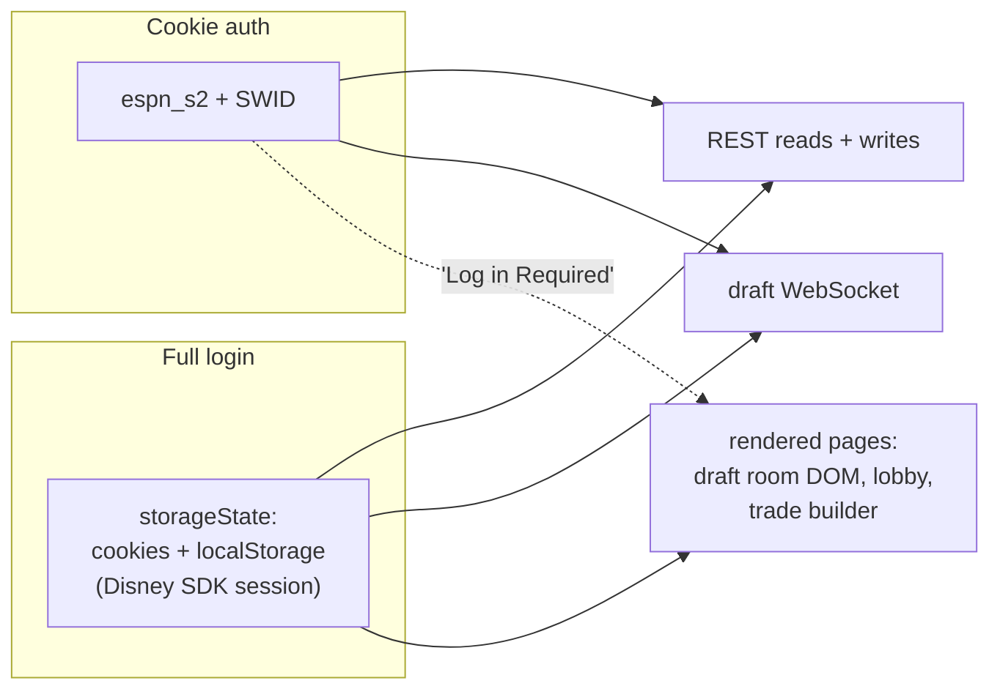
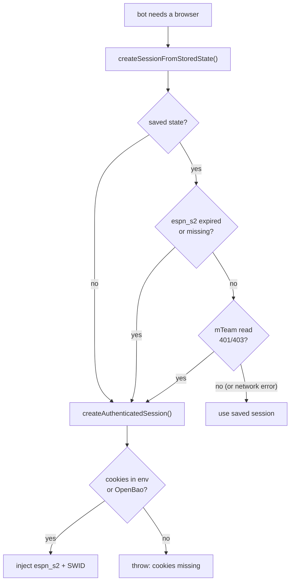
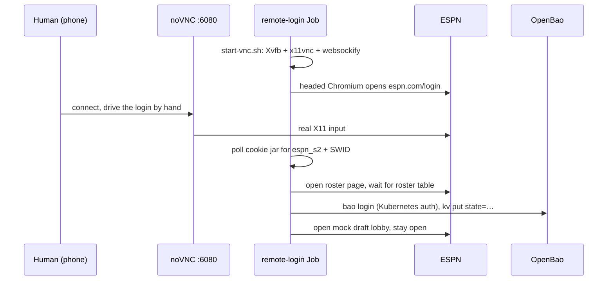
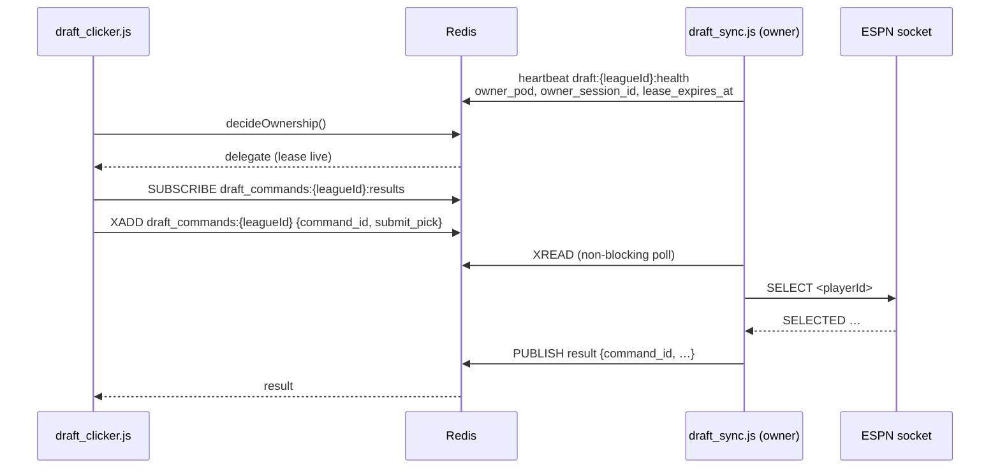

ESPN auth has two surfaces, and only one of them needs a real login. This page explains which bots need which, where credentials come from, and what to do when they expire.

:::tip[The short version]
- `espn_s2` + `SWID` cookies are enough for REST reads, writes and the draft WebSocket.
- A **rendered** ESPN page also needs a Disney identity session, which only a real interactive login creates.
- Scripting the login form doesn't work: invisible reCAPTCHA Enterprise blocks it. A human logs in, over VNC if remote, and the full session is saved.
- An expired session raises `SessionExpiredError`, which retries after 30 s. The weekly health check catches it early.
:::

## Two auth surfaces



| Surface | Needs | Used by |
|---|---|---|
| REST API and draft WebSocket | `espn_s2` and `SWID` cookies | Lineup, waiver sniper, draft clicker's socket path, trade reads and writes |
| Rendered pages | A real interactive login (Disney/MyDisney identity SDK, a JWT from `espn.connections.edge.bamgrid.com`) | Draft room DOM fallback, practice-draft lobby, DOM observer, trade builder |

Confirmed live on 08-17: a Playwright page with valid cookies showed ESPN's "Log in Required" overlay, while REST and the socket kept working with the same cookies. The overlay is client-side React, so it never appears in HTTP logs.

## Where credentials come from

| Credential | Production | Local fallback |
|---|---|---|
| `espn_s2`, `SWID` | `ESPN_S2` and `SWID` env vars from an ExternalSecret | `bao kv get` on `OPENBAO_ESPN_SECRET_PATH` (default `secret/fantasy/espn`, fields `espn_s2` and `swid`) |
| Saved full session | A file at `ESPN_SESSION_STATE_FILE` | `bao kv get` on `OPENBAO_ESPN_SESSION_STATE_PATH` (default `secret/fantasy/espn-session-state`, field `state`) |
| Recon login | — | `.espn-storage-state.json` in the repo root, gitignored |

The local fallbacks shell out to an already-authenticated `bao` CLI. They never log in to OpenBao themselves. Only the remote login Job writes to OpenBao.

## Opening a session

`auth.js` has two entry points. Bots that render a page try the saved session first.



| Function | What it does |
|---|---|
| `createSessionFromStoredState` | Loads the saved `storageState`. Returns `null`, not an error, when there's none, its `espn_s2` has expired, or a 5 s `mTeam` probe gets 401 or 403. A network error or 5xx keeps the saved session. The probe is skipped without `ESPN_LEAGUE_ID` and `CURRENT_YEAR`. |
| `createAuthenticatedSession` | Injects `espn_s2` (httpOnly) and `SWID` on `.espn.com`. Fails before launching Chromium if no cookies are found. |

Callers use `(await createSessionFromStoredState()) ?? (await createAuthenticatedSession())`. Both launch Chromium with `--disable-blink-features=AutomationControlled`, a 1280×720 viewport and a user agent picked from a small pool of desktop Chrome strings. Set `CDP_DEBUG_PORT` to expose DevTools for watching a bot live.

## Refreshing the login remotely

The login form can't be scripted. A human logs in through a real browser instead, and the worker saves the full session. To do that from a phone, run the remote login Job.



:::info[Prerequisites]
- `kubectl` access to the cluster.
- An OpenBao Kubernetes-auth role that lets the Job's ServiceAccount write the session-state path. Without it, the login works but the state isn't saved and the Job exits non-zero.
- `ESPN_LEAGUE_ID` and `ESPN_TEAM_ID` set in `k8s/remote-login-job.yaml`.
:::

1. Start the Job:
   ```bash
   kubectl delete job remote-login --ignore-not-found -n default
   kubectl apply -f k8s/remote-login-job.yaml
   kubectl logs -f job/remote-login -n default
   ```
2. Forward the noVNC port: `kubectl port-forward job/remote-login 6080:6080 -n default`.
3. Open `http://localhost:6080/vnc.html`, click Connect and log in to ESPN by hand.
4. **Verify:** the log says `Saved full session state to OpenBao`. The browser then moves to the mock draft lobby and stays usable until `activeDeadlineSeconds` (2 h) ends or you delete the Job.

VNC has no password by default. Keep the port reachable only through `kubectl port-forward` or a private network, or set `VNC_PASSWORD`.

| Variable | Default | Purpose |
|---|---|---|
| `LOGIN_WAIT_TIMEOUT_MS` | 30 min | How long to wait for a login |
| `LOGIN_POLL_INTERVAL_MS` | 5 s | Cookie-jar poll interval |
| `OPENBAO_ESPN_SESSION_STATE_PATH` | `secret/fantasy/espn-session-state` | Where the state is written |
| `OPENBAO_K8S_ROLE` | `fantasy-browser-worker` | OpenBao Kubernetes-auth role |

:::warning[Don't automate the login]
An earlier attempt filled the Disney OneID form correctly, and submit silently did nothing: invisible reCAPTCHA Enterprise held the callback. That result is final. Repeated automated attempts risk the account being flagged.

The remote login uses real VNC on purpose. x11vnc injects input at the X server, which looks like a real mouse and keyboard to Chromium. CDP-dispatched input (`page.mouse`, `page.keyboard`) is still programmatic and falls in the category reCAPTCHA already blocked. Don't replace VNC with a CDP relay.
:::

For local recon, `draft_recon.js` saves the same kind of state to `.espn-storage-state.json` after you log in by hand. Set `FORCE_MANUAL_LOGIN=1` to force a fresh login. See [Recon tools](recon-tools.md#how-recon-logs-in).

## The session registry

The draft room allows one connection per league, team and member, and a new JOIN evicts the old one. Draft sync holds the socket for the whole draft, so the draft clicker must not open its own. `session_registry.js` lets the clicker hand its pick to the socket owner instead.



| Piece | Key or channel | Notes |
|---|---|---|
| Ownership lease | `owner_pod`, `owner_session_id`, `lease_expires_at` inside `draft:{leagueId}:health` | The lease is a few heartbeats long, much shorter than the key's 1 h TTL, so a crashed owner stops looking live within seconds. |
| Command stream | `draft_commands:{leagueId}` | `XADD` with a JSON `payload`. The owner polls it with a non-blocking `XREAD` so its other timers keep running. |
| Results | `draft_commands:{leagueId}:results` (pub/sub) | The requester subscribes **before** it publishes, then waits for its `command_id`. |
| Rejections | `draft_pick_rejected:{leagueId}` (pub/sub) | Published when ESPN refuses a pick, so core can react within the same clock. |

`decideOwnership()` returns `delegate` when a live lease exists and `become_owner` otherwise. A Redis error or unparseable lease falls back to `become_owner`, so a broken registry doesn't wedge the clicker. If delegation fails, the clicker opens a direct session.

## Session health checks

`session_health.js` checks each surface before a bot depends on it.

| Check | Surface | Runs in |
|---|---|---|
| `assertCookieSessionValid` | An authenticated `mTeam` REST read. No navigation. | Draft clicker before submitting. Draft sync at start and every 15 s REST reconcile. |
| `assertRenderedSessionValid` | Opens the roster page and waits for the roster table | The weekly `check_espn_session.js` CronJob. Draft sync at start when `DRAFT_MODE=mock`. |

The [Session health check](../bots/session-health.md) page covers the CronJob schedule.

## When cookies expire

| Symptom | Raised as | What happens |
|---|---|---|
| HTTP 401 or 403 from REST or a write | `SessionExpiredError` | The message is requeued after 30 s, not dropped. It succeeds once credentials are refreshed. |
| Redirect to `/login`, or no roster table | `SessionExpiredError` | Same |
| HTTP 404 for the league | `PermanentError` | Not an auth problem. The league or room is gone. |
| Saved session expired or rejected | `null` from `createSessionFromStoredState` | Falls back to cookie injection. Rendered pages then show "Log in Required". |
| No cookies in env or OpenBao | Plain `Error` before launch | Fix the secret. |

To fix an expired session:

1. **Cookies:** copy `espn_s2` and `SWID` from a logged-in browser and run `bao kv put secret/fantasy/espn espn_s2=<espn_s2> swid=<SWID>`. The ExternalSecret syncs it to the cluster. Never commit the values.
2. **Saved session** (needed for rendered pages): run the [remote login Job](#refreshing-the-login-remotely).
3. **Verify:** re-run the `espn-session-healthcheck` CronJob by hand, or wait for the next Monday run, and check it exits 0.

The cookie pair and the saved session are refreshed separately. Refresh both before a draft.

## Related

- [Session health check](../bots/session-health.md)
- [Draft room](draft-room.md#the-room-is-single-session)
- [Draft clicker](../bots/draft-clicker.md), [Draft sync](../bots/draft-sync.md)
