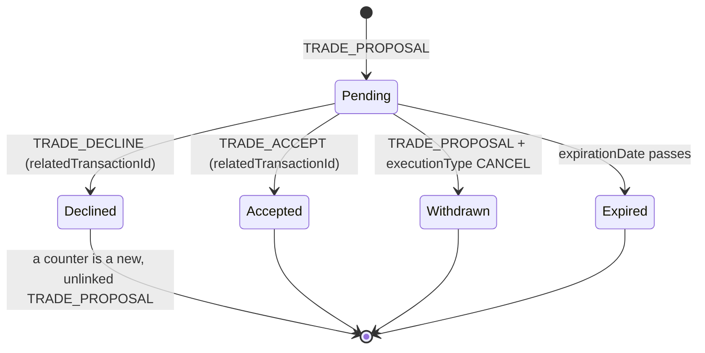
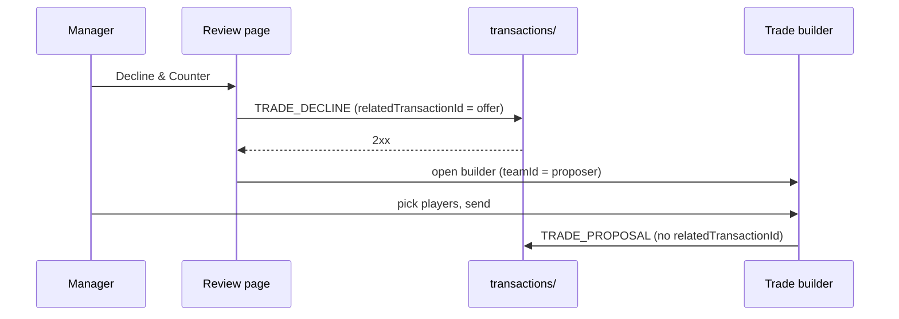

Trades use the same `transactions/` endpoint and envelope as [lineup moves](transactions.md), with `TRADE_*` types. Most of this page comes **from the bundle**: no trade has been proposed, accepted or declined on the wire yet, so `espn_api.js` keeps those writes behind flags until a capture confirms them.

:::tip[The short version]
- A proposal is a `TRADE_PROPOSAL` with one `TRADE` item per player.
- Accept and decline are `TRADE_ACCEPT` and `TRADE_DECLINE` with `relatedTransactionId` set to the offer.
- **ESPN has no linked counter.** "Decline & Counter" declines the offer, then sends a new, unlinked proposal.
- A withdrawal is a related `TRADE_PROPOSAL` with `executionType: "CANCEL"`.
:::



## Sources

| Source | What it showed |
|---|---|
| Bundle build `35f16ade75be-1.504`, read 10-03 | `sendTrade` → `TransactionService.proposeTrade` → `saveTransaction`. The live page load ran under a write guard that blocked 0 and allowed 0 ESPN writes. |
| Bundle build `d77c8eabc3df-1.513`, read 10-09 | The trade review page, Decline & Counter, `acceptTrade`, `declineTrade`, `cancelTrade`. Fetched with plain unauthenticated GETs; no session ran. |
| Live reads, 10-03 | `mPendingTransactions` empty state and `mTransactions2` history. |

The minified function names change with every ESPN build.

## Proposing a trade

```json
{
  "isLeagueManager": false,
  "teamId": 8,
  "type": "TRADE_PROPOSAL",
  "memberId": "{SWID-WITH-BRACES}",
  "scoringPeriodId": 4,
  "executionType": "EXECUTE",
  "items": [
    { "playerId": 3117251, "type": "TRADE", "fromTeamId": 1, "toTeamId": 8 },
    { "playerId": -16019,  "type": "TRADE", "fromTeamId": 1, "toTeamId": 8 },
    { "playerId": 4429795, "type": "TRADE", "fromTeamId": 8, "toTeamId": 1 }
  ],
  "expirationDate": "2026-10-05T15:04:05.123Z",
  "comment": ""
}
```

| Field | Meaning |
|---|---|
| `teamId` | The **proposer**: you. |
| `items[].fromTeamId` / `toTeamId` | Direction comes from the player's current team. Their players go to you, yours go to them. |
| `scoringPeriodId` | `league.status.latestScoringPeriod` |
| `expirationDate` | Now plus 1 to 7 days, default **2**, as ISO-8601 UTC with milliseconds. Only proposals carry it. |
| `comment` | Note to the other manager. `""` when empty. |

Optional extra items:

| Item | Shape |
|---|---|
| Draft pick | `{overallPickNumber, type: "DRAFT_TRADE", fromTeamId, toTeamId}` |
| FAAB | `{acquisitionBudget, type: "ACQUISITION_BUDGET_TRADE", fromTeamId, toTeamId}` |
| Roster-fix drop | `{playerId, type: "DROP", fromTeamId}`, added when ESPN answers that a drop is required |

Confidence: **high** for the endpoint, headers and envelope, which share `submitLineup`'s live-verified code path. **Medium-high** for the item and expiration encoding, read from code only.

## Accepting, declining and withdrawing

| Action | `type` | `relatedTransactionId` | Other fields |
|---|---|---|---|
| Accept | `TRADE_ACCEPT` | The offer | `items` only for roster-fix `DROP`s |
| Decline | `TRADE_DECLINE` | The offer | `comment`. Optional "dealbreaker" items: `{playerId}` or `{overallPickNumber, type: "DRAFT_TRADE"}`. |
| Withdraw (proposer) | `TRADE_PROPOSAL` | The offer | `executionType: "CANCEL"` |
| Veto, uphold | `TRADE_VETO`, `TRADE_UPHOLD` | The offer | League actions. The worker never sends these. |

`buildTradeResponseBody` builds accept and decline only. `trade_response.js` won't send either until the action is listed in `VERIFIED_TRADE_RESPONSE_ACTIONS` and `PENDING_TRADE_SHAPE_VERIFIED` is `true`. Both are empty or `false` today.

## Countering: Decline & Counter

The review page `/football/tradereview?leagueId={id}&transactionId={offer}` has Accept, Decline and **Decline & Counter** (`button.action-buttons[data-trade-type="TRADE_AND_COUNTER"]`). Both decline buttons call the same handler.



- The counter is an ordinary proposal. Nothing carries the declined offer's ID into it.
- The decline can't be undone. If the counter then fails, the original offer is already gone.
- The worker must link decline and counter in its own records (`execution_log`'s `related_transaction_id` and `thread_root_id`). `COUNTER_LINKAGE_VERIFIED` stays `false`, and no proposal carrying a `relatedTransactionId` is sent live.

## How the client judges the response

| Response | Client branch | What the worker does |
|---|---|---|
| Status < 400 | Success. The body is the created transaction. | Records success |
| Status ≥ 400 | Error. The body has `details[]` of `{type, message, resolution?, metaData.teamid}`. | 401/403 → `SessionExpiredError`. Other 4xx except 429 → `PermanentError` with `status` and `details`. |
| 429 or 5xx | Error | Marked `outcomeUnknown`: the offer may have changed anyway. Reconcile before retrying. |
| Thrown request (timeout after 50 s) | Exception | Unknown outcome |

A `details[].type` of `TRAN_ROSTER_LIMIT_EXCEEDED_*`, `TRAN_ROSTER_POSITION_LIMIT_EXCEEDED*` or `TRAN_ROSTER_SLOT_LIMIT_EXCEEDED*` makes ESPN's builder ask for a roster-fix drop and resubmit. See [Error codes](error-codes.md).

## Reading offers back

| Read | What to look for |
|---|---|
| `mPendingTransactions` | `pendingTransactions[]` entries with `type` in `TRADE_PROPOSAL` or `TRADE_ACCEPT` where `teamId` or any item's team is yours. The key is absent when nothing is pending. |
| `mTransactions2` + TRADE_* filter | How an offer left the pending list (below). |

How the inbox reads an offer that disappeared from the pending list:

| History row | Read as |
|---|---|
| `TRADE_ACCEPT` naming the offer | Accepted |
| `TRADE_DECLINE` naming the offer | Declined, or countered if we hold a counter for it |
| `TRADE_VETO` naming the offer | Vetoed |
| `TRADE_PROPOSAL` naming the offer, `executionType: "CANCEL"` | Withdrawn |
| Any other `TRADE_PROPOSAL` naming the offer | Countered |
| `status: "CANCELED"` on the offer itself | Withdrawn |

None of these rows has been seen live yet. The inbox records unexpected values in `parse_issues` instead of guessing: a status other than `PENDING`, a missing `expirationDate`, more than two teams, or an unknown item type.

## Clubhouse findings

A read-only probe on 10-03, under the write guard, found:
- The clubhouse loads `mPendingTransactions` as part of a larger view set, and makes no other trade call.
- The clubhouse page has no inline pending-trade section. Whether a real pending trade adds a card, banner or modal is unobserved.

## What's still to capture

Read-only first. With a real incoming offer, the manager clicks the buttons themselves in a headed session while traffic is recorded. The bot never clicks. Each run needs explicit approval.

1. Leave `trade_inbox.js --refresh` running. The first real offer is appended to `espn-pending-transactions.jsonl`. Turn it into a fixture with SWIDs redacted and set `PENDING_TRADE_SHAPE_VERIFIED` in the same change.
2. Read `mTransactions2` for earlier weeks with the TRADE_* filter to see real trade rows and how they link.
3. Record an Accept or Decline to confirm the response body, then list the action in `VERIFIED_TRADE_RESPONSE_ACTIONS`.
4. Record a Decline & Counter. Confirm the decline body, whether ESPN links the new proposal, the decline row in `mTransactions2`, and the counter's pending row.

## Related

- [Recon tools](recon-tools.md) for `trade_recon.js` and the write guard
- [Trade builder](../bots/trade-builder.md), [Trade inbox](../bots/trade-inbox.md), [Trade response](../bots/trade-response.md)
