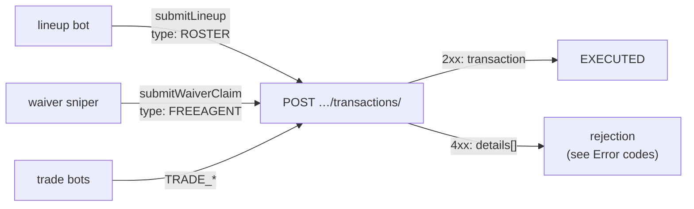

Every ESPN roster write, including trades, is a POST of one JSON envelope to the `transactions/` endpoint. This page covers ROSTER (lineup and IR) and FREEAGENT (add and drop) bodies. Trades are on [their own page](trades.md).



## Request

```text
POST https://lm-api-writes.fantasy.espn.com/apis/v3/games/ffl/seasons/{seasonId}/segments/0/leagues/{leagueId}/transactions/
Content-Type: application/json
x-fantasy-source: kona
x-fantasy-platform: espn-fantasy-web
Cookie: espn_s2=<espn_s2>; SWID={SWID-WITH-BRACES}
```

ESPN's own client adds `?platformVersion=<build hash>`. The worker leaves it off, and writes still succeed. `x-fantasy-platform` is `espn-fantasy-web`, not `kona-PROD`. That was the one correction from the first guess.

## The envelope

Every write uses the same top-level fields.

| Field | Value |
|---|---|
| `isLeagueManager` | `false`. The worker never acts as league manager. |
| `teamId` | Your team. For a trade, the team sending the request. |
| `type` | `ROSTER`, `FREEAGENT`, or a `TRADE_*` type |
| `memberId` | The brace-wrapped `SWID` |
| `scoringPeriodId` | The current week, from the roster read. Don't hard-code it. |
| `executionType` | `EXECUTE` (`CANCEL` only to withdraw a trade) |
| `items` | The moves. Omitted when empty. |

## Lineup moves (`ROSTER` / `LINEUP`)

Confirmed live on 09-12: a FLEX and bench swap, sent by `submitLineup` and then reverted. The body matches ESPN's own client exactly.

```json
{
  "isLeagueManager": false,
  "teamId": 8,
  "type": "ROSTER",
  "memberId": "{SWID-WITH-BRACES}",
  "scoringPeriodId": 5,
  "executionType": "EXECUTE",
  "items": [
    { "playerId": 4239996, "type": "LINEUP", "fromLineupSlotId": 20, "toLineupSlotId": 21 }
  ]
}
```

A batch of moves is one transaction with several `LINEUP` items.

### Slot IDs

Confirmed live on 08-11 from `mSettings` and the slot labels on the team page. The map lives in `src/selectors/lineup_slots.json`.

| Slot | `lineupSlotId` | Notes |
|---|---|---|
| QB | 0 | |
| RB | 2 | `RB1` and `RB2` are the same slot with two openings. Strip the ordinal before mapping. |
| WR | 4 | |
| TE | 6 | |
| D/ST | 16 | Also `defaultPositionId` 16. D/ST player IDs are negative. |
| K | 17 | `defaultPositionId` is 5. |
| Bench | 20 | |
| IR | 21 | Not drafted into. Excluded from draftable-slot counts. |
| FLEX | 23 | |

The slot **counts** in that file are a fallback. `readRoster` reads the league's real `lineupSlotCounts` every time, so a settings change can't break the bot.

## IR moves

An IR move is an ordinary `LINEUP` item into or out of slot 21. Confirmed live on 10-06:

| Move | Result |
|---|---|
| An ACTIVE player, bench 20 → IR 21 | HTTP 409, `TRAN_ROSTER_INELIGIBLE_IR_NOT_INJURED`. No change. |
| An INJURY_RESERVE player, bench 20 → IR 21 | HTTP 200, `status: EXECUTED` |
| The same player, IR 21 → bench 20 | HTTP 200, `EXECUTED`. The reverted roster matched the snapshot. |

The worker models these as `{kind: "ir"}` and `{kind: "activate_ir"}` swaps. Each becomes one `LINEUP` item, and moves out of IR go first. `planIrMove` only starts a new IR move for **OUT** or **INJURY_RESERVE**. ESPN stays the final authority.

<details>
<summary>Evidence for which injury statuses are IR-eligible</summary>

- **From the bundle** (build `9f97de9ffb23-1.506`): the Manage IR list filters on `player.injured`. ESPN's injury metadata marks OUT and INJURY_RESERVE as `injured: true`, and QUESTIONABLE, DOUBTFUL and SUSPENSION as `injured: false`.
- `eligibleSlots` is no help. Healthy players list slot 21 too.
- **Confirmed live:** `mTransactions2` across weeks 1 to 5 showed seven executed moves into slot 21. Every current IR occupant in the league was OUT or INJURY_RESERVE. History doesn't keep the status at insertion time.
- **Unverified:** whether ESPN rejects QUESTIONABLE, DOUBTFUL or SUSPENSION. No test write was sent.

</details>

:::note[Open question: a healthy player stuck on IR]
ESPN's frontend disables trade proposals when `ineligibleIrPlayer` is true. Whether a lineup move or add is also rejected, and with which code, is unconfirmed. Capture it only when the state happens naturally and a live write is approved.
:::

## Adds and drops (`FREEAGENT`)

`submitWaiverClaim` sends one transaction with an `ADD`, a `DROP`, or both.

```json
{
  "isLeagueManager": false,
  "teamId": 8,
  "type": "FREEAGENT",
  "memberId": "{SWID-WITH-BRACES}",
  "scoringPeriodId": 5,
  "executionType": "EXECUTE",
  "items": [
    { "playerId": 11122, "type": "ADD", "toTeamId": 8 },
    { "playerId": 3916148, "type": "DROP", "fromTeamId": 8 }
  ]
}
```

| Item | Team field | Confidence |
|---|---|---|
| `ADD` | `toTeamId`: your team. **Required.** | Confirmed live, 10-07: an ADD without it got HTTP 409 `TRAN_ITEM_TO_TEAM_ID_MISSING`. |
| `DROP` | `fromTeamId`: your team | From the bundle (the roster-fix drop shape). |

:::warning[Still unverified]
No successful FREEAGENT write has been captured. These are unconfirmed:
- that ESPN accepts `type: "FREEAGENT"` with `EXECUTE` for an immediate pickup;
- whether an in-window waiver claim needs `type: "WAIVER"` and a FAAB `bidAmount` instead;
- the status and body of an add to a full roster.

`waiver_recon.js --watch-save` is the tool for this. See [Recon tools](recon-tools.md).
:::

Either half of a claim can be sent alone. A redelivered message that already landed its add can send just the drop.

## Ordering dependent moves

For an IR move followed by a pickup, wait for the IR action's `verified_complete` before submitting the add. Give each action its own idempotency key.

## How the worker classifies the response

| Response | Error | Retried? |
|---|---|---|
| 2xx | None. The body is the created transaction. | — |
| 401, 403 | `SessionExpiredError` | Yes, after 30 s |
| Other 4xx except 429 | `PermanentError` | No. It would fail the same way again. |
| 429, 5xx, network error | Plain `Error` | Yes |

Every write appends its request, status and first 500 bytes of the response to `recon-output/espn-write-log.jsonl`. Cookies are never in that file. Set `DEBUG_CAPTURE=0` to turn it off.

## Related

- [Error codes](error-codes.md)
- [Lineup bot](../bots/lineup.md)
- [Waiver sniper](../bots/waiver-sniper.md)
