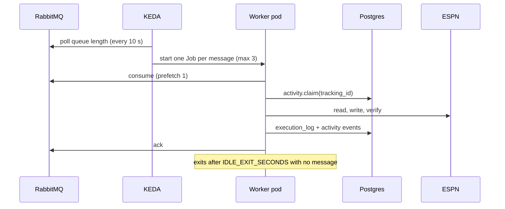
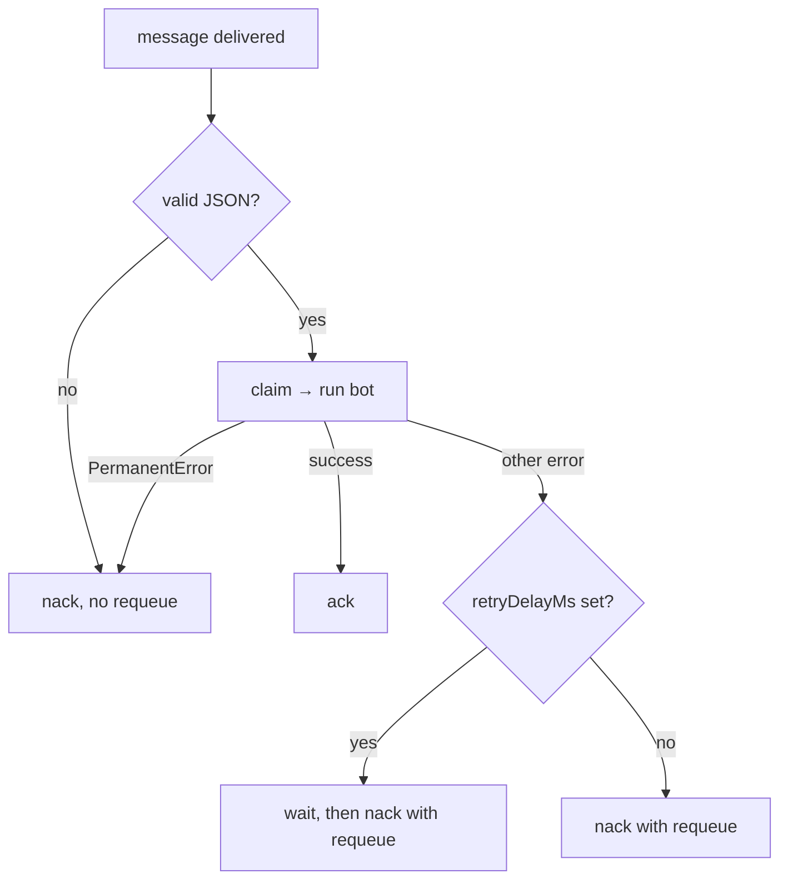

One container image runs every bot. Queue messages start `src/index.js` through a KEDA `ScaledJob`. Scheduled bots run as Kubernetes CronJobs that call a bot file directly.

:::tip[The short version]
- One message per Job pod, three pods at most, and the pod exits after 120 s idle.
- A message is acknowledged only after the bot finishes. A `PermanentError` discards it; any other error requeues it after a delay.
- Live ESPN writes are gated by `DRY_RUN` and, for trades, by extra switches and a human approval.
:::

## How is a bot started?

| Style | Started by | Entrypoint | Bots |
|---|---|---|---|
| Queue consumer | KEDA `ScaledJob` `fantasy-browser-worker-scaler` | `src/index.js` | Lineup, waiver sniper, draft clicker, trade evaluation, trade negotiation, trade builder, trade response, async LLM |
| Scheduled | Kubernetes CronJob | `node src/bots/<file>.js` | Trade inbox, trade scan, rumor digest, ESPN session check |
| Long-running Job | The core API creates it for a draft | `node src/bots/draft_sync.js` | Draft sync |

## How is the worker scaled?

| Setting | Value | Why |
|---|---|---|
| Trigger | One RabbitMQ `QueueLength` trigger per queue, `value: 1` | One Job per waiting message. |
| `pollingInterval` | 10 s | How often KEDA checks the queues. |
| `maxReplicaCount` | 3 | Caps concurrent Chromium instances. The backlog waits in RabbitMQ. |
| `IDLE_EXIT_SECONDS` | 120 | The worker exits with code 0 so the Job completes. Unset or `0` runs forever. |
| Memory limit | 1200 Mi | A hard ceiling for Chromium. |
| Draft-day overlay | `minReplicaCount: 1`, no idle exit | Keeps a warm, logged-in browser. |

Queues with a KEDA trigger: `lineup_updates`, `waiver_actions`, `draft_targets`, `trade_evaluations`, `trade_negotiations`, `llm_requests`, `trade_submissions`, `trade_responses`.

:::warning[`trade_proposals` has no trigger]
The worker still consumes `trade_proposals`, but an idle worker never wakes for it. Don't publish scans to that queue. Use the [trade scan](bots/trade-proposal-and-scan.md) CronJob or CLI.
:::

## How are messages acknowledged and retried?

The consumer sets `prefetch(1)` on the whole channel, so one message is in flight across every queue.

| Error | Class | Result | Delay before requeue |
|---|---|---|---|
| Bad payload, missing config, stale id, a request ESPN can never accept | `PermanentError` | Discarded. For `lineup_updates`, `waiver_actions` and `draft_targets` the broker dead-letters it to the matching `.dlq`. | None |
| ESPN cookies rejected | `SessionExpiredError` | Requeued | 30 s |
| Network blip, HTTP 5xx or 429, failed verification | Plain `Error` (often wrapped with `withRetryDelay`) | Requeued | 5 s |
| Another worker owns the same `tracking_id` | Plain `Error` | Requeued | 1 s |

:::note
A syntactically valid message that parses to `null`, an array or a scalar would throw a `TypeError` that looks transient. Each bot calls `requirePlainObjectPayload` first so these become permanent failures.
:::

Other consumer behavior:

- On connect it retries 10 times with exponential backoff from 2 s.
- If the broker closes the connection, the process exits with code 1 so Kubernetes restarts it.
- `lineup_updates`, `waiver_actions` and `draft_targets` are declared by the broker. The worker only checks they exist. It declares the other queues as durable.

## What do `DRY_RUN` and the other gates do?

`DRY_RUN` accepts `0`, `false` or `no` to go live. Any other non-blank value keeps the bot in dry-run mode. Each bot picks its own default when the variable is unset.

| Bot | Default when unset | What else controls a live write |
|---|---|---|
| Lineup | **Live** | Set `DRY_RUN=true` to plan without writing. |
| Waiver sniper | Dry run | A boolean `dry_run` in the message overrides the environment. |
| Draft clicker | Dry run | A message with `mode: "practice"` defaults to live. An explicit `DRY_RUN` always wins. |
| Trade builder | Dry run | Reads `TRADE_DRY_RUN` first (same values as `DRY_RUN`) and falls back to `DRY_RUN` when it is unset, so trades can go live without arming the other bots. Also needs `TRADE_SUBMIT_ENABLED=true`, a matching human approval, verified selectors and, for counters, verified counter linkage. |
| Trade response | Dry run | Reads only `DRY_RUN`, never `TRADE_DRY_RUN`. Also needs `TRADE_RESPONSE_ENABLED=true`, a matching human approval, a verified action and a verified pending-trade shape. |
| Trade negotiation | Never sends | It only stages an offer, with no approval. |

With any gate closed, trade bots fill or build the request and record what they would have sent.

## How does the worker avoid duplicate writes?

Three layers protect against a redelivered message.

| Layer | Where | What it does |
|---|---|---|
| Producer idempotency | Core API | Repeats of the same `idempotency_key` return `duplicate`. TTLs: lineup 30 min, draft pick 15 min, waiver 7 days. |
| Action claim | `activity.claim` (Postgres `activity_actions`) | Takes a per-`tracking_id` advisory lock. Skips an action already `finished`, `submitted` or `skipped`. |
| Bot checks | Each bot | Reads ESPN first and sends only what is still missing. |

`activity.claim` also guards ambiguous writes:

- Before an external write the bot calls `beforeExternalWrite`, which marks the action `external_write_started`.
- If a redelivery finds that mark, or the action has already been attempted 5 times, the action becomes `failed` with a `manual_verification_required` event. The bot throws a `PermanentError`. A person checks ESPN before anything is sent again.
- A `draft_targets` message past its `expires_at` is skipped with the outcome `expired`.

Trade bots add their own claims in `execution_log`, keyed by `offer_key` or `decision_key`. See the [trade builder](bots/trade-builder.md) and [trade response](bots/trade-response.md) pages.

## How do I know a write worked?

Each bot re-reads ESPN after it writes. The result goes to `activity_actions.outcome`.

| Outcome | Meaning |
|---|---|
| `verified_complete` | A fresh ESPN read shows the change. |
| `awaiting_processing` | ESPN accepted the request but the change isn't visible yet, as with a queued waiver claim. |
| `unknown` | Nothing was sent (dry run) or the result couldn't be confirmed. |
| `expired` | The message was too old to act on. |

## Related

- [Message contracts](message-contracts.md)
- [Telemetry](telemetry.md)
- [Bots](bots/index.md)
