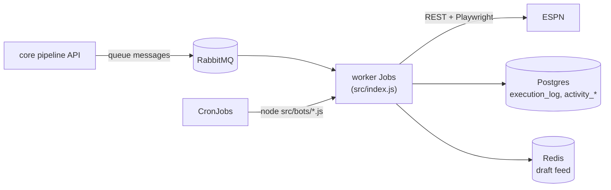

The browser worker turns decisions from the core pipeline into actions on ESPN. It consumes RabbitMQ queues and runs a few scheduled jobs. Start here to find the page you need.

## Where do I look?

| I want to… | Read |
|---|---|
| Understand scaling, acks, retries, `DRY_RUN` and idempotency | [How bots run](how-bots-run.md) |
| Find which bot handles a queue or job | [Bots](bots/index.md) |
| Check the JSON a queue expects | [Message contracts](message-contracts.md) |
| Read or write logs, spans and `execution_log` rows | [Telemetry](telemetry.md) |
| Look up ESPN's undocumented draft protocol, auth and write requests | [ESPN reverse-engineering notes](espn-reverse-engineering.md) |

## Related

- The core pipeline publishes every queue message except the ones the worker publishes itself. See [Message contracts](message-contracts.md) for who sends what.
- Setup and the environment variables the image reads are in the repository `README.md`.
