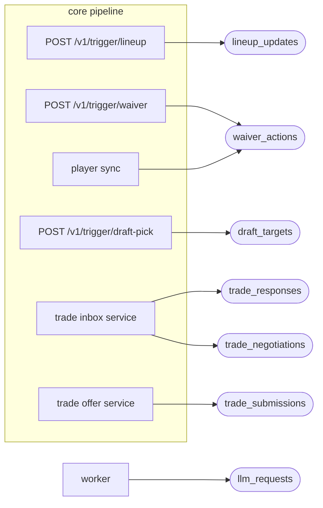

This page lists each queue and its message fields. The producer's models are the source of truth: the core API's Pydantic models in `src/api/routes.py` and the trade services. The worker's validation is in the bot named in each section.

:::note
Every message is a JSON object. The core API adds `tracking_id`, `league_id` and `traceparent` to the queue body, and removes `decision_inputs`. Fields marked "Core" are sent by the core API, but the worker may ignore them.
:::



## Which queues exist?

| Queue | Publisher | Consumer | Declared by | KEDA trigger |
|---|---|---|---|---|
| `lineup_updates` | Core `/v1/trigger/lineup` | [Lineup](bots/lineup.md) | Broker | Yes |
| `waiver_actions` | Core `/v1/trigger/waiver`, player sync | [Waiver sniper](bots/waiver-sniper.md) | Broker | Yes |
| `draft_targets` | Core `/v1/trigger/draft-pick` | [Draft clicker](bots/draft-clicker.md) | Broker | Yes |
| `trade_evaluations` | None scheduled | [Trade evaluation](bots/trade-evaluation-and-negotiation.md) | Worker | Yes |
| `trade_negotiations` | Core trade inbox service | [Trade negotiation](bots/trade-evaluation-and-negotiation.md) | Worker | Yes |
| `trade_proposals` | None | [Trade proposal](bots/trade-proposal-and-scan.md) | Worker | **No** |
| `trade_submissions` | Core trade offer service | [Trade builder](bots/trade-builder.md) | Worker | Yes |
| `trade_responses` | Core trade inbox service | [Trade response](bots/trade-response.md) | Worker | Yes |
| `llm_requests` | The worker (`requestLlmAsync`) | [Async LLM](bots/async-llm-requests.md) | Worker | Yes |

"Broker" queues are declared by the broker's definitions and policy. The worker only checks that they exist. "Worker" queues are declared durable by whoever connects first.

## `lineup_updates`

| Field | Type | Required | Notes |
|---|---|---|---|
| `tracking_id` | string | Core | |
| `team_id` | string | Yes | |
| `optimized_swaps` | array | Yes | Swaps and IR moves. See below. |
| `idempotency_key` | string | No | Core only. |

Swap entry (no `kind`, or `kind: "swap"`):

| Field | Type | Required | Notes |
|---|---|---|---|
| `drop_player_id` | string | Yes | ESPN id, moved to the bench. |
| `add_player_id` | string | Yes | ESPN id, moved into `slot`. |
| `slot` | string | Yes | `QB`, `RB1`, `FLEX` and so on. |
| `drop_player_name`, `add_player_name`, `matchup_multiplier` | | No | Core only. |

IR entry:

| Field | Type | Required | Notes |
|---|---|---|---|
| `kind` | `ir` or `activate_ir` | Yes | |
| `player_id` | string | Yes | ESPN id. |
| `slot` | string | Yes | `IR` for `ir`. Any non-IR slot for `activate_ir`. |

```json title="lineup_updates"
{
  "tracking_id": "00000000-0000-4000-8000-000000000001",
  "team_id": "8",
  "optimized_swaps": [
    { "drop_player_id": "1000001", "add_player_id": "1000002", "slot": "FLEX" },
    { "kind": "ir", "player_id": "1000003", "slot": "IR" }
  ]
}
```

## `waiver_actions`

| Field | Type | Required | Notes |
|---|---|---|---|
| `tracking_id` | string | Core | |
| `team_id` | string | Core | The worker uses `ESPN_TEAM_ID`. |
| `player_id` | string | Yes | ESPN id of the add. |
| `name`, `team` | string | Core | Display name and NFL team. |
| `drop_player_id` | string | No | Omit for an add-only claim. |
| `dry_run` | boolean | No | Overrides `DRY_RUN`. |
| `idempotency_key` | string | No | Core only. |

Player sync also publishes an alert shape to this queue:

| Field | Type |
|---|---|
| `event_type` | `INJURY_STATUS_CHANGE` |
| `timestamp` | ISO 8601 string |
| `player_id`, `name`, `team` | string |
| `new_injury_status` | string |

## `draft_targets`

| Field | Type | Required | Notes |
|---|---|---|---|
| `tracking_id` | string | Core | |
| `team_id` | string | Yes | Numeric string. |
| `player_id` | string | Yes | ESPN id. Negative for a D/ST. |
| `name` | string | Yes | |
| `position`, `pro_team` | string | Core | |
| `league_id` | string | No | Overrides `ESPN_LEAGUE_ID`. |
| `pick_number` | integer | No | |
| `expires_at` | number | No | Unix seconds. |
| `mode` | `live` or `practice` | No | |
| `idempotency_key` | string | No | |

## `trade_evaluations`

| Field | Type | Required | Notes |
|---|---|---|---|
| `incoming_player_ids` | string[] | Yes | Non-empty. Core's internal ids. |
| `outgoing_player_ids` | string[] | Yes | Non-empty. No id on both sides. |
| `season`, `week` | integer | Yes | |
| `tracking_id` | string | No | |

## `trade_negotiations`

The fields of `trade_evaluations`, plus:

| Field | Type | Required | Notes |
|---|---|---|---|
| `offering_team_id` | string | Yes | ESPN team that made the offer. |
| `related_transaction_id` | string | No | Offer being countered. |
| `thread_root_id` | string | No | Needs `related_transaction_id`. |

## `trade_proposals`

| Field | Type | Required | Notes |
|---|---|---|---|
| `season` | integer | Yes | 2000 or later. |
| `week` | integer | Yes | 1 to 18. |
| `exclude_team_ids` | string[] | No | ESPN team ids. |
| `tracking_id` | string | No | |

:::warning
Nothing publishes here and no trigger wakes a worker for it. Use the trade scan CronJob.
:::

## `trade_submissions`

| Field | Type | Required | Notes |
|---|---|---|---|
| `season` | integer | Yes | |
| `to_team_id` | string | Yes | |
| `incoming_player_ids`, `outgoing_player_ids` | string[] | Yes | ESPN ids. |
| `source` | `counter_offer`, `proposal` or `manual` | No | Default `manual`. |
| `message` | string | No | |
| `related_transaction_id`, `thread_root_id` | string | No | |
| `approval` | object | No | `{offer_key, approved_by}`. Without it the run is a dry fill. |
| `tracking_id` | string | No | |

```json title="trade_submissions"
{
  "tracking_id": "00000000-0000-4000-8000-000000000002",
  "season": 2026,
  "to_team_id": "3",
  "incoming_player_ids": ["1000004"],
  "outgoing_player_ids": ["1000005"],
  "source": "proposal",
  "approval": { "offer_key": "<64 hex characters>", "approved_by": "<you>" }
}
```

## `trade_responses`

| Field | Type | Required | Notes |
|---|---|---|---|
| `espn_transaction_id` | string | Yes | |
| `action` | `accept` or `decline` | Yes | |
| `approval` | object | To send | `{decision_key, approved_by, reviewed_note}` |
| `comment` | string | No | |
| `retry` | object | No | `{of_claim_id, approved_by, verified_not_answered}` |
| `tracking_id` | string | Core | New for a retry. |

## `llm_requests`

| Field | Type | Required | Notes |
|---|---|---|---|
| `request_id` | string | Yes | UUID matching the `llm_async_requests` row. |
| `prompt` | string | Yes | |
| `opts` | object | No | Passed to `completeWithFallback`, for example `systemPrompt` and `callSite`. |

## Not queues

Two bots take no queue message.

| Job | Input |
|---|---|
| Trade inbox | CLI flags. |
| Rumor digest | Database rows. |

Draft sync and the draft clicker also talk over Redis. See [Draft sync](bots/draft-sync.md) for those keys.

## Related

- [How bots run](how-bots-run.md)
- [Bots](bots/index.md)
