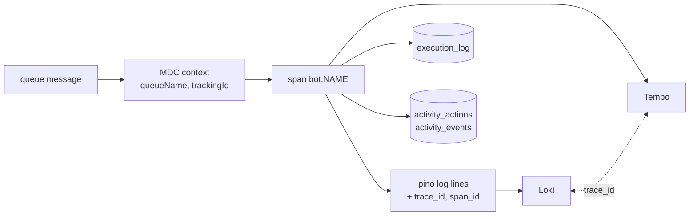

Every bot logs through one logger, runs inside one span wrapper, and leaves rows in Postgres. Use this page to find a run in Loki, Tempo or Grafana.



## How do I write a log line?

Pass the message first and extra fields second. Pass the real `Error` under `err` to get a stack trace.

```js title="src/telemetry/logger.js"
logger.error("Claim failed", { err: error, permanent: error.permanent === true });
logger.info(`Evaluating claim for ${name}`);
```

| Rule | Why |
|---|---|
| `logger.<level>(message, extra)` | Matches every call site. Pino's native order is the reverse. |
| Put the error under `err`, not `err.message` | Pino's `err` serializer keeps the stack. |
| Don't hand-interpolate league, team or tracking id | The context adds them to every line. |
| Never log cookies, tokens or API keys | Logs ship to Loki. |

Levels are `debug`, `info`, `warn` and `error`. Set `LOG_LEVEL` to change the floor. The default is `info`.
Each line writes its level as a string. The container runtime supplies the timestamp, so pino omits it.

## What does every log line carry?

| Field | Source |
|---|---|
| `queueName`, `trackingId` | Seeded by the queue consumer for each message. |
| `botName` | Set by `withInstrumentation`. |
| `leagueId`, `teamId` | Added with `updateContext` once a bot knows them. |
| `trace_id`, `span_id` | The active OpenTelemetry span. Loki links to Tempo on `trace_id`. |

## What does a trace look like?

`withInstrumentation` opens a span named `bot.<name>` around each message or scheduled run.

| Attribute | Value |
|---|---|
| `worker.bot_name` | Queue name or bot name. |
| `worker.tracking_id` | The action id, when present. |
| `messaging.destination` | The queue, for queue messages. |
| `worker.permanent_error` | Set on failure. |

The service name is `browser-worker` in the cluster, from `OTEL_SERVICE_NAME`. AMQP and Postgres calls are instrumented automatically. The core API injects a `traceparent` into each message, so a trace can span the publish and the work.

`shutdownTelemetry` flushes spans on exit and never rejects. A dropped trace is acceptable. A dropped job is not.

## Which database rows does a run leave?

| Table | Written by | Holds |
|---|---|---|
| `execution_log` | `withInstrumentation` | One row per run: `transaction_type`, `bot_name`, `status`, `duration_ms`, `error_message`, `trace_id`. Feeds the Grafana worker health panel. |
| `execution_log` | Specific bots | Per-action rows: `draft_pick_click`, `trade_negotiation`, `trade_offer_submit`, `trade_response`, `trade_scan_claim`, `trade_inbox`. |
| `activity_actions` | `activity.claim`, `activity.observe` | Execution state and outcome for each action. |
| `activity_events` | `activity.event` | Stage history: `running`, `submitted_to_espn`, `verified_complete`, `worker_error` and others. |
| `activity_sessions` | LLM client | One row per LLM run. |
| `llm_call_metrics` | LLM client | One row per provider attempt, for the LLM dashboard. |
| `run_log` | `withInstrumentation` | The run audit log behind the web UI's Runs tab: job, trigger (`schedule`/`manual` from `RUN_CRONJOB`/`RUN_K8S_JOB`, or `queue` with the `tracking_id`), status and a summary. A queue run's parent is the run that queued its action. |
| `run_links` | `run_log.link` | What a run read and wrote: the digest's raw signal inputs and rumor signal outputs, and each LLM session. |

`execution_log` and `run_log` writes are best-effort. A failed write is logged and never fails or requeues the message. Claims that guard an external write are the exception: they fail closed.

:::note[Redaction]
`activity` redacts values under keys that look like passwords, tokens, cookies or API keys, and any environment secret longer than 8 characters. LLM prompts and responses are stored as a hash and a length unless `LLM_HISTORY_CAPTURE_CONTENT=true`.
:::

## How do I trace one action?

1. Take the `tracking_id` from the core API response or the Activity view.
2. Search Loki for it. Every line for that message carries it.
3. Open the `trace_id` from any line in Tempo.
4. Query `execution_log` by `trace_id` for the outcome and duration.

## Related

- [How bots run](how-bots-run.md)
- [Bots](bots/index.md)
